+++

title = "Advanced Versioning Techniques"
description = "Worktrees, rebasing, squashing, history rewriting, submodules, large repositories"
outputs = ["Reveal"]

[reveal_hugo]
transition = "slide"
transition_speed = "fast"
custom_theme = "custom-theme.scss"
custom_theme_compile = true

[reveal_hugo.custom_theme_options]
targetPath = "css/custom-theme.css"
enableSourceMap = true

+++

# Advanced Versioning Techniques

{}

---

# Annotated Tagging

Git supports two types of tags:
* **lightweight** tags
    * *default option*
    * simply a name for an object (usually a commit)
    * meant for creating **private** or **temporary** annotations!
* **annotated** tags
    * Produced with `-a` (unsigned), `-s`, or `-u` options
    * Creates a *new object*
    * Contain *message*, *creation date*, *tagger name* and *email*, and an optional *signature*
    * Annotated tags are **meant for release**
    * Some commands (most notably, `git describe`) ignore lightweight tags by default

---

# Signing commits

Nice people *sign* commits, certifying their authorship.

* Signed commits appear with a  on GitHub

If you do not have a signature yet, [time to create one](https://central.sonatype.org/pages/working-with-pgp-signatures.html)
* Creation: `gpg --gen-key`
* List: `gpg --list-keys`
* Distribution: `gpg --keyserver hkps://keys.openpgp.org --send-keys <YOUR_KEY_ID>`

Once you have a private key to sign with, you can configure Git to use it for signing things by setting the user.signingkey config setting.

`git config --global user.signingkey <YOUR_KEY_ID>`

---

## Signing with SSH keys

Since Git 2.34, commits and tags can be signed with an **SSH key** instead of a GPG key

* No GPG toolchain, no keyservers: you likely already have an SSH key (e.g., for GitHub)

```bash
git config --global gpg.format ssh
git config --global user.signingkey ~/.ssh/id_ed25519.pub
git config --global commit.gpgsign true   # sign every commit
git config --global tag.gpgsign true      # sign every annotated tag
```

* On GitHub, add the public key as a **Signing Key** (separate from *Authentication Keys*, even if it is the same key)
* Local verification (`git log --show-signature`) requires a list of trusted keys:
    * `git config --global gpg.ssh.allowedSignersFile ~/.ssh/allowed_signers`
    * one line per key: `<email> <public key>`

---

# Commit trailers

**Trailers** are `Key: value` lines at the *end* of a commit message, used to add *structured metadata*

```text
feat(parser): support multi-line string literals

Literals delimited by triple quotes can now span multiple lines.

Closes: #142
Co-authored-by: Jane Doe <jane.doe@example.com>
Signed-off-by: John Smith <john.smith@example.com>
```

* `Co-authored-by:` multiple authors for one commit (GitHub shows all of them)
* `Signed-off-by:` the author certifies they have the *right to submit* the change
    * *Developer Certificate of Origin* (DCO), required by many projects (e.g., Linux)
    * Added automatically with `git commit -s`
* `Closes:`, `Fixes:`, `Reviewed-by:`, `Assisted-by:`...: project conventions

---

## Working with trailers

Adding trailers without editing the message by hand:

```bash
git commit -s -m "fix: handle empty input"            # adds Signed-off-by
git commit --trailer "Co-authored-by: Jane Doe <jane.doe@example.com>"
```

Querying trailers:

```bash
# list co-authors across the history
git log --format='%(trailers:key=Co-authored-by,valueonly)' | sort -u
# parse trailers of a message
git log -1 --format=%B | git interpret-trailers --parse
```

**Trailers and AI assistance**:
* Many projects require *disclosing* AI-generated contributions, typically via a trailer
    * e.g., `Co-authored-by:` an agent identity, or `Assisted-by:`
* Coding agents often add such trailers by default
* A `Signed-off-by:` is a statement *by a human*: an agent cannot certify the origin of the code for you

---

# Stashing

Classic situation:
1. Work on some project, have the project in an inconsistent state
2. Something needs to be fixed on another branch

$\Rightarrow$ You don't want to commit half-finished work, but you can't lose what you have done...

## `git stash` to the rescue

Stashing takes the dirty state of the working directory and saves it on a **stack** of *unfinished changes* that you can *reapply at any time*
  * application on different branches allowed!

---

## Practical stashing

* `git stash`
  * **Pushes** *all* dangling changes (staged or unstaged) to the stash
* `git stash list`
  * **Shows** all the accumulated stashes
* `git stash apply [stash@{N}] [--index]`
  * No option specified: **Re-applies**, *without removing* from the stash, the *latest* stashed change
  * If `stash@{N}`, applies the *N-th* stashed change
  * If `--index` is specified, the changes that were staged at the time of push get *re-staged*
* `git stash drop stash@{N}`
  * **Deletes** the *N-th* stashed change
* `git stash pop`
  * **Re-applies** *the most recent* stash, *removing* it from the stash
  * Same as `git stash apply && git stash drop stash@{0}`

---

# Multiple working trees

Stashing works for *quick* interruptions, but:

* The *urgent fix* may take hours, and you would like to keep your work *open*
* You need to *build or test* another branch while you keep working (e.g., a long test suite)
* You want to *review* a colleague's PR *running* it, without touching your work
* You want *several agents* working *in parallel* on different tasks, without interfering

<br>

A second `git clone` works, but duplicates *the whole history*, and the clones do not share branches

**Worktrees**: *multiple working directories* attached to the *same* repository

---

## `git worktree`

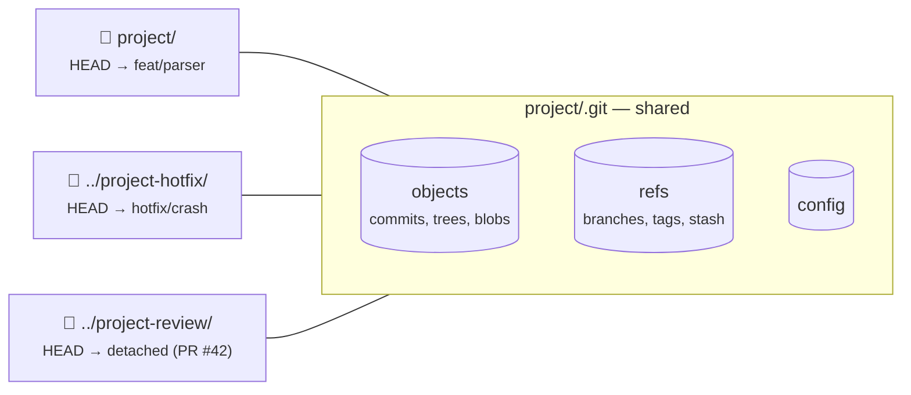

* **Shared**: objects, branches, tags, remotes, configuration, stash
    * A commit made in a worktree is *immediately visible* from the others
* **Per worktree**: `HEAD`, index (staging area), working files
    * Including *untracked and ignored* files: build outputs, dependencies, IDE settings...
* A branch can be checked out in **only one** worktree at a time

---

## Working with worktrees

```bash
git worktree add ../project-hotfix hotfix/crash # check out an existing branch
git worktree add -b feat/cli ../project-cli master # create a new branch from master
git fetch origin pull/42/head # GitHub exposes PRs as refs
git worktree add --detach ../project-review FETCH_HEAD
git worktree list # show all worktrees
git worktree remove ../project-hotfix # delete a worktree (not the branch!)
git worktree prune # clean up worktrees deleted by hand
```

Practical notes:

* Place worktrees *outside* the main working directory (e.g., *siblings*), or in an *ignored* folder
* Plan for disk space!
* *Agents*: many coding agents can create a worktree per task, so that parallel sessions do not overwrite each other's files

---

## Stash, worktree, or clone?

| | `git stash` | `git worktree` | second `git clone` |
|---|---|---|---|
| Use for | Short interruptions | Parallel work on the same repo | Independent copies |
| Working directories | One | Many | Many |
| History | Shared | Shared (one `.git`) | *Duplicated* |
| Branches | Shared | Shared, one checkout per branch | *Independent*, sync via remote |
| Cost | None | Working files + build | Full repository + build |

---

# Classic branch reconciliation, a recap

## Merging

* In classic merging, diverging branches are reconciled through a **merge commit**

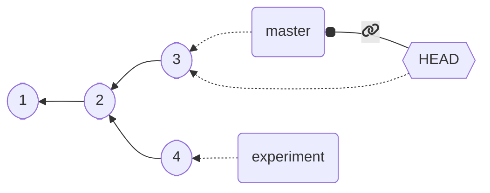

---

## Merging

`git merge experiment`

{}

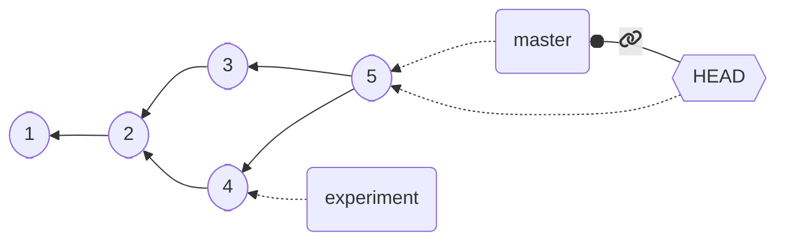

{}

---

# Advanced merging: rebase

* Merging is not the only way to reconcile diverging branches
* We may want, for instance, to simulate that `4` was developed after `3`
    * For instance, because it was on a separate part of the codebase
* Merging *forces you* to record the creation and reunion of a development line, but in some cases it may be undesirable
    * Project history *hard to understand* because of too many merges
    * The separation was actually a successful small experiment

**Rebasing** provides a way to alter the project history by *changing the parent* (re-base) of existing commits

---

## Rebase reconciliation


{}

`git checkout experiment && git rebase master`

{}

---

## Rebase merge

`git checkout experiment && git rebase master`

{}

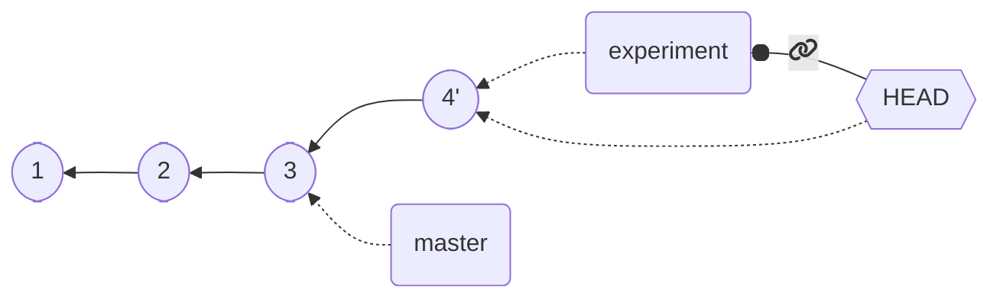

{}

{}

`git checkout master && git merge`

{}

---

## Fast-forwarding after a rebase

`git checkout master && git merge`

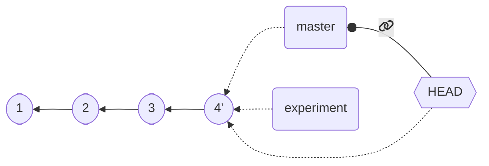

*fast-forward!*

---

## Advanced rebasing

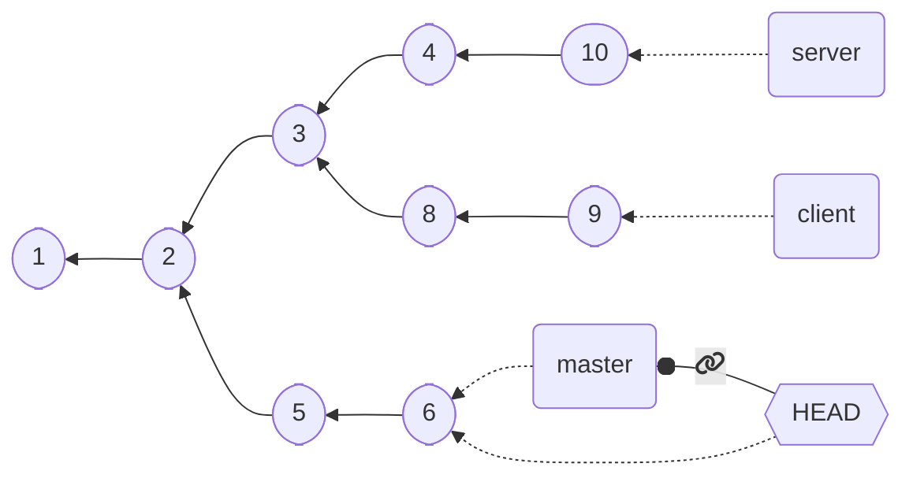

We want to leave `server` as is, but rebase `client` onto `master`

{}

Option `--onto` can be used to transplant entire branches
* `git rebase --onto destination start end`
    * pick commits from `start` to `end`
    * replay them starting from `destination`

{}

---

## Advanced rebasing

`git rebase --onto master server client`

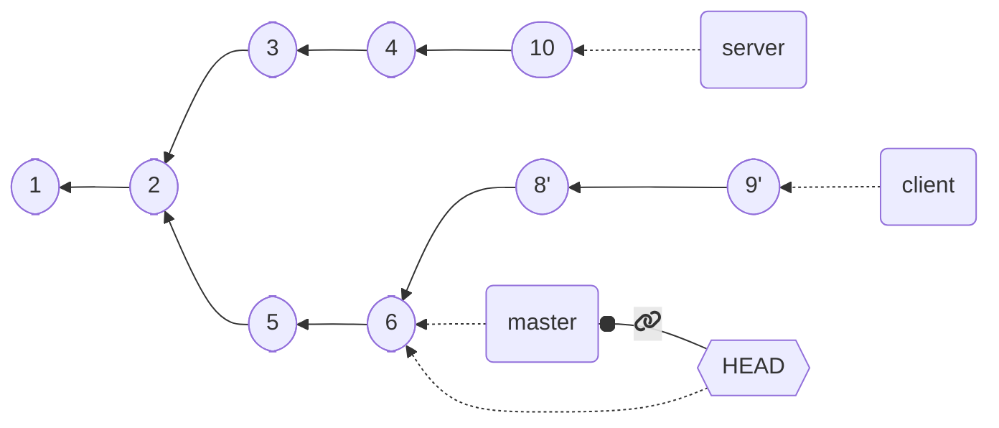

Reads: *pick all commits from `server` (excluded) to `client` (included), remove them and replay them starting from `master`*

Or: *pick all commits from `client`, remove all those in `server`, then replay them starting from `master`*

---

## Pull with rebase

`pull` is a non-atomic operation (roughly) equivalent to `git fetch && git merge FETCH_HEAD`

There is no reason for the operation of reconciliation to be `merge`: it could well be `rebase`!

`git fetch && git rebase FETCH_HEAD` (roughly)

*Both operations* are actually supported! The full commands would be:
* `git pull --rebase=false` $\Rightarrow$ reunite using merge (the historical default)
* `git pull --rebase=true` $\Rightarrow$ reunite using rebase!

* **Note:** new versions of git require explicit configuration!
  * `git config --global pull.rebase [true/false]`
* **Note:** rebase is more sensitive to modified files in the worktree!
  * Typical solution: `git stash && git pull --rebase=true && git stash pop`
  * Shortcut: `git pull --rebase=true --autostash`

---

## Perils of rebase

> **Do not rebase commits that exist outside your repository**

Rebasing *rewrites the project history* and as such generates *incompatible histories*
* Remote pushes may get *refused*!
* pushing with `--force` *rewrites history remotely* and **may delete other people's commits**!
* `git pull --rebase` is safe, if the local commits were never pushed to any remote
    * It is actually a good practice to default to it
    * `git config --global pull.rebase true`

---

## Rebasing with multiple remotes

A (very common) situation: the same repository is pushed to *two* remotes, both receiving changes
* e.g., a LaTeX paper on **GitHub** (CI, issues) and on **Overleaf** (co-authors edit online)
* We configured `pull.rebase true`, and we push to both

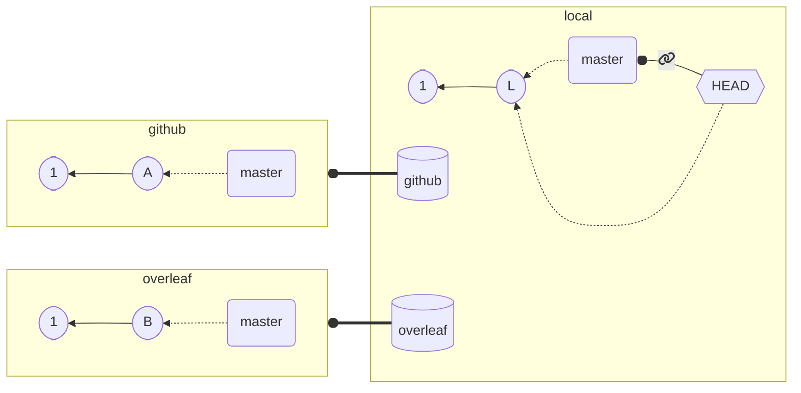

* A collaborator pushed `A` on GitHub, a co-author added `B` on Overleaf, we committed `L` locally

---

## Rebasing with multiple remotes

`git pull --rebase github master && git push github master`

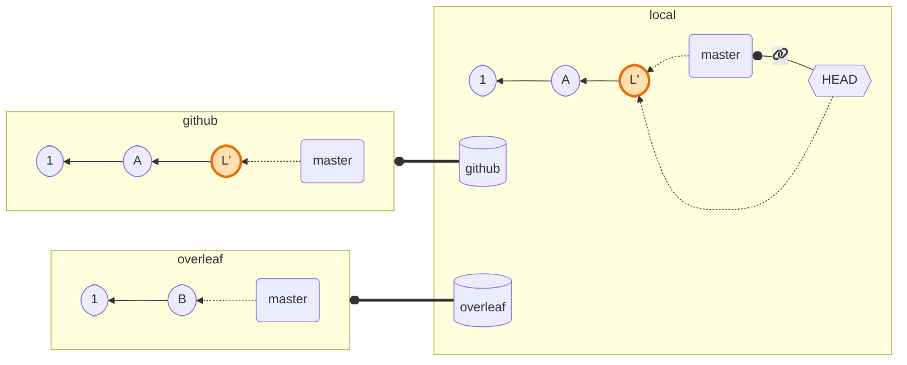

* `L` is replayed on top of `A`, becoming `L'`, and published on GitHub
* So far, so good

---

## Rebasing with multiple remotes

`git pull --rebase overleaf master && git push overleaf master`

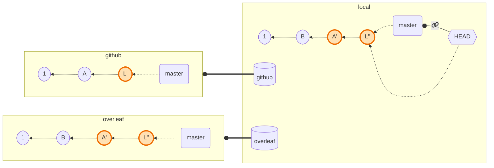

* *Both* `A` and `L'` are local commits not on Overleaf: they get **replayed** on top of `B`
* `A'` and `L''` are *copies* of `A` and `L'` (same changes, *different hashes*), and now they are **published**
* We just *rebased commits that exist outside our repository*!

---

## Rebasing with multiple remotes

`git push github master` ❌ *rejected* (non-fast-forward), so: `git pull --rebase github master && git push github master`

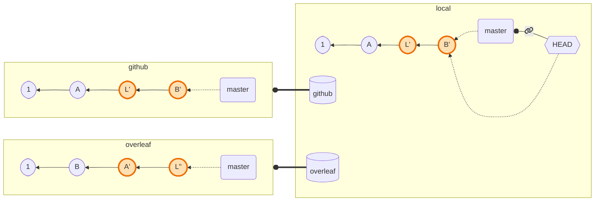

* `A'` and `L''` are *skipped*: git detects that GitHub already has the same changes
* `B` is replayed as `B'`, and published on GitHub
* GitHub and Overleaf now have the *same content*, but **no common commit** after `1`

---

## Rebasing with multiple remotes: no convergence

`git push overleaf master` ❌ *rejected*, so: `git pull --rebase overleaf master`

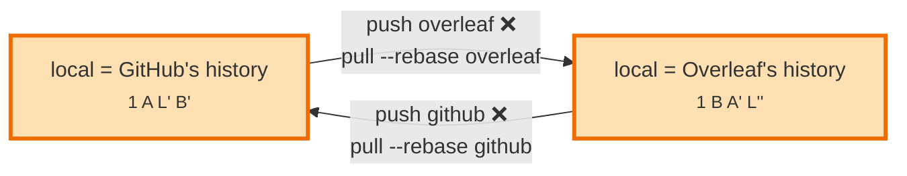

* Every local commit is skipped: the local branch simply *jumps* to the other history, and the other push fails
* The two histories **never converge**
* Every *new* commit on either side gets replayed, and its copy published on the other remote
    * Duplicates *accumulate*, conflicts get solved *twice* (possibly differently)

---

## Rebasing with multiple remotes: the way out

**Merge** creates a commit that *both* histories contain

`git pull --no-rebase github master && git push github master && git push overleaf master`

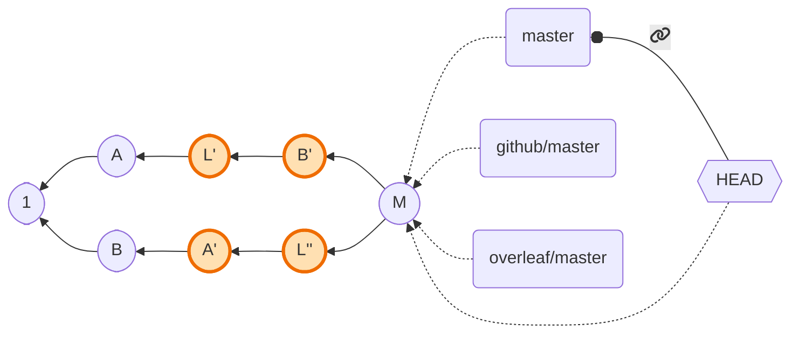

* Both remotes are now at `M`: from now on, pulls and pushes are *fast-forwards*
* The duplicated commits stay in the history *forever*
* **Lesson**: a commit pushed to *any* remote *exists outside your repository*
    * With multiple writable remotes, integrate with **merge** (e.g., `git config pull.rebase false` in that repository)

---

## Rebasing or merging?

Select depending on what you *conceptually* want:
* I want a **record of what actually happened**: then **merge**
    * History is preserved
    * Messy commits are there
* I want to **tell the story of how my project was made**: then **rebase**
    * History is *modified*
    * Commits are cleaner

They tell two stories:
* *rebase* is the book
* *merge* is the story of how the book was written

---

## Resolving the same conflict again: `rerere`

Rebasing *repeatedly* (e.g., a long-lived branch kept up to date with `master`) means
solving **the same conflicts over and over**

**rerere** (*reuse recorded resolution*) remembers how you solved a conflict, and re-applies the resolution automatically

```bash
git config --global rerere.enabled true
```

* When a conflict is resolved and committed, git *records* the conflicting hunks and their resolution
* When the *same* conflict appears again (in a merge, a rebase, a cherry-pick), git *re-applies* the resolution
    * The file is still reported as conflicting, for you to *check* (or set `rerere.autoUpdate true`)
* `git rerere diff`: shows what would be re-applied
* `git rerere forget <path>`: drops a wrong recorded resolution

---

# Compaction: squashing

## Squashing

Squashing is the practice of *reassembling multiple commits into a single one*
* Lets you forget "experimental" commits
* Lets you merge temporary changes into a single one
* *Simplifies* history
* *Alters* history
* Can be performed via `merge` or manually

---

## Squashing manually

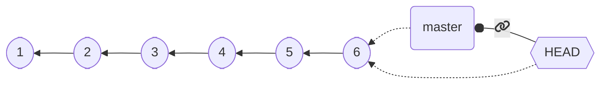

`git reset --soft HEAD~4`

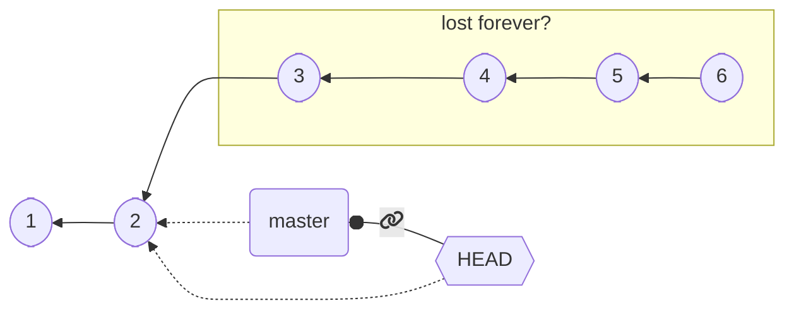

The worktree still has all changes from `6`! What if we `commit`?

---

## Squashing manually

`git commit`

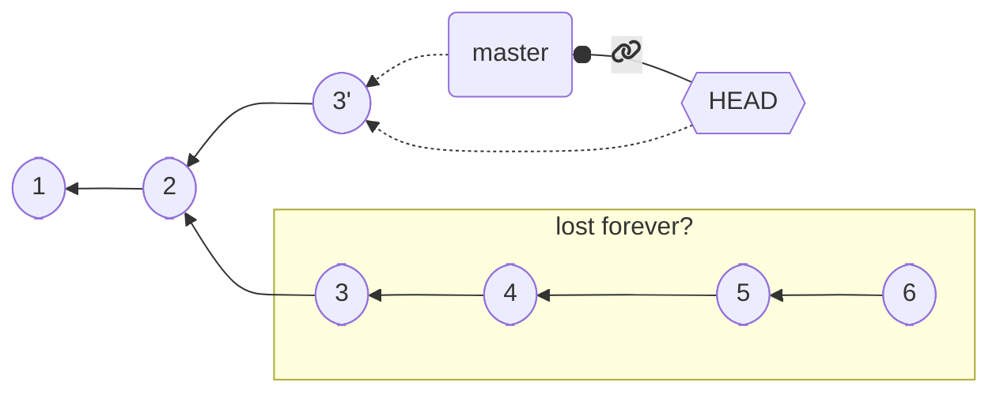

Commits `3` to `6` have been *squashed* into a single commit `3'`!

---

## Squash with `merge --squash`


Use a branch to "keep alive" the commits discarded by the `reset`
(or we remember the hash, or we use a tag)

`git branch target`

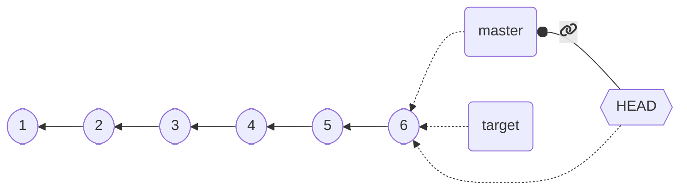

now move `master` back to the last commit to preserve

---

## Squash with `merge --squash`

now move `master` back to the last commit to preserve

`git reset --hard HEAD~4`

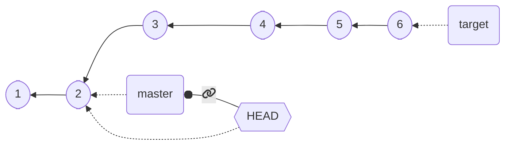

Ready: merge all changes in `target`, creating a single commit!

---

## Squash with `merge --squash`

`git merge --squash target && git commit`

```mermaid
flowchart RL
  HEAD{{"HEAD"}}
  master(master)
  target(target)

  C6([6]) --> C5([5]) --> C4([4]) --> C3([3]) --> C2([2]) --> C1([1])
  C3a([3']) --> C2

  master -.-> C3a
  target -.-> C6

  HEAD -.-> C3a
  HEAD --"fas:fa-link"--o master

  class HEAD head;
  class master,experiment,client,server,target branch;
  class C1,C2,C3,C3a,C4,C5,C6,C7,C8,C9,C10 commit;
```

Remove the old branch: `git branch -D target`

```mermaid
flowchart RL
  HEAD{{"HEAD"}}
  master(master)

  C2([2]) --> C1([1])
  C3a([3']) --> C2

  master -.-> C3a

  HEAD -.-> C3a
  HEAD --"fas:fa-link"--o master

  class HEAD head;
  class master,experiment,client,server,target branch;
  class C1,C2,C3,C3a,C4,C5,C6,C7,C8,C9,C10 commit;
```

---

## Squash, merge, or rebase?

Squashing alters history *more* than rebase does

**Merge** when you want to *retain history*, keeping track of what happened

**Rebase** only when you are the only one with the commits, to favor *linearity*

**Squash** when some of the commits are somewhat "tests", points in time you do not want to get back to anyway


---

# Rewriting history

## Rebase interactive

* Rebase can be used in *interactive* mode (option `-i`) to *rewrite history*
* Interactive rebase stops after each commit to allow for changes, such as editing the message or adding files

`rebase -i <tree-ish>`

* Considers all commits **after** <tree-ish> and down to the current HEAD
* The list of commits is shown in a text editor
* Each line is a command to be executed on the commit
* Commands are executed sequentially from top to bottom

---

## Rebase interactive: commands

The most important commands are:

* `pick` or `p` $\Rightarrow$ use commit, no changes
    * note: this is a rebase, so the commit is *replayed*
* `reword` or `r` $\Rightarrow$ use commit, but edit the commit message
* `edit` or `e` $\Rightarrow$ use commit, but stop for amending
* `squash` or `s` $\Rightarrow$ use commit, but meld into previous commit
* `fixup` or `f` $\Rightarrow$ like "squash", but discard this commit's log message
* `drop` or `d` $\Rightarrow$ remove commit

---

## Rebase interactive: example

```console
$ git rebase -i HEAD~7
pick 41669e3 chore(deps): update shared-slides digest to 550f3a8
pick 053bfca chore(deps): update shared-slides digest to 249f7ae
pick 7af4843 chore(deps): update themes/reveal-hugo digest to 6c4bcb7
pick 3e4259e chore(deps): update shared-slides digest to 5384aaf
pick 117fa35 chore(deps): update themes/reveal-hugo digest to f9ead1f
pick 6eb514b chore(deps): update shared-slides digest to 0b573b0
pick 17743ec migrate from `GetJSON` to `resources.GetRemote` with `transform.Unmarshal`
```

Commits are listed in the *reverse order* compared to `git log`.

* Commands can be *changed*
* Commits can be *reordered*

```text
reword 053bfca chore(deps): update shared-slides digest to 249f7ae
drop 41669e3 chore(deps): update shared-slides digest to 550f3a8
squash 7af4843 chore(deps): update themes/reveal-hugo digest to 6c4bcb7
squash 3e4259e chore(deps): update shared-slides digest to 5384aaf
squash 117fa35 chore(deps): update themes/reveal-hugo digest to f9ead1f
pick 6eb514b chore(deps): update shared-slides digest to 0b573b0
edit 17743ec migrate from `GetJSON` to `resources.GetRemote` with `transform.Unmarshal`
```

* *save and exit* the editor
* Git *rewinds you back to the last commit in that list*
* Git processes the commands, and, if needed, drops you on the command line to make changes
* There, you have full control, you can even *split* commits by committing different changes multiple times
* Once you're satisfied with your changes, run `git rebase --continue`

---

## Fixup commits and autosquash

Typical situation: during a review, you find a mistake in a commit *three commits ago*

Instead of editing the history by hand, record the fix *declaring which commit it fixes*:

```bash
git commit --fixup=a1b2c3d               # creates "fixup! <message of a1b2c3d>"
git commit --fixup=amend:a1b2c3d         # also replaces the message of a1b2c3d
git commit --fixup=reword:a1b2c3d        # only replaces the message
```

When the branch is ready, let git reorder and meld the fixups:

```bash
git rebase -i --autosquash master
git config --global rebase.autoSquash true   # make it the default
```

```text
pick a1b2c3d feat(parser): support multi-line strings
fixup 9f8e7d6 fixup! feat(parser): support multi-line strings
pick 4c5d6e7 test(parser): multi-line strings
```

* Fixes stay *visible* as separate commits *during review*
* History is *clean* after the final rebase

---

## Stacked branches

Large features are better delivered as *small, dependent* pull requests: a **stack**

```mermaid
flowchart RL
  master(master)
  model(feat/model)
  api(feat/api)
  ui(feat/ui)

  C4([4]) --> C3([3]) --> C2([2]) --> C1([1])
  C6([6]) --> C5([5]) --> C4
  C7([7]) --> C3

  master -.-> C7
  model -.-> C4
  api -.-> C5
  ui -.-> C6

  class master,model,api,ui branch;
  class C1,C2,C3,C4,C5,C6,C7 commit;
```

* Each branch is a pull request *targeting the previous one*: `feat/api` $\rightarrow$ `feat/model` $\rightarrow$ `master`
* Small PRs are *easier to review*, and flow better through *merge queues*
* Problem: `master` moved to `7`. Rebasing `feat/ui` rewrites `4`, `5`, and `6`...
  <br>but `feat/model` and `feat/api` would still point to the *old* commits!

---

## Stacked branches: `--update-refs`

`git rebase --update-refs master` (from `feat/ui`)

```mermaid
flowchart RL
  master(master)
  model(feat/model)
  api(feat/api)
  ui(feat/ui)

  C3([3]) --> C2([2]) --> C1([1])
  C7([7]) --> C3
  C4a(["4'"]) --> C7
  C6a(["6'"]) --> C5a(["5'"]) --> C4a

  master -.-> C7
  model -.-> C4a
  api -.-> C5a
  ui -.-> C6a

  class master,model,api,ui branch;
  class C1,C2,C3,C4a,C5a,C6a,C7 commit;
```

* Every branch pointing *inside* the rebased range is *moved* along with its commits
* `git config --global rebase.updateRefs true` to make it the default
* Then, push all branches (`git push --force-with-lease origin feat/model feat/api feat/ui`)
* Merge *bottom-up*: once `feat/model` is merged, `feat/api` is retargeted to `master`

---

# The golden rule of history rewriting

> **Don’t push your work until you’re happy with it**

> One of the cardinal rules of Git is that, since *so much work is local within your clone*,
you have a great deal of freedom to *rewrite your history __locally__*.
However, *once you push your work, it is a different story* entirely,
and **you should consider pushed work as final** unless you have good reason to change it.
In short, you should avoid pushing your work until you’re happy with it and ready to share it with the rest of the world.


---

## Cherry picking

Selecting and importing a single commit (or commit range) from another branch

`git cherry-pick <tree-ish>`
* Picks `<tree-ish>` and adds it to `HEAD`
* If `<tree-ish>` is a branch name, cherry picks the last commit of the branch

`git cherry-pick from..to`
* cherry picks commit range from ref `from` to ref `to`

Cherry picking is often useful for applying *fixes* or *patches* which are in development from other branches.

---

# Bug hunting: bisection

Bisection is a technique to find the commit that introduced a bug

1. First, run `git bisect start`
2. Mark a commit as *good* and another as *bad* to identify a search range
    * Checkout a revision with the bug and `git bisect bad`
    * Checkout a revision without the bug and `git bisect good`
3. Git will then binary search the commit history, checking out commits in the middle automatically
4. For each commit, test if the bug is present or not, and mark it by `git bisect good` or `git bisect bad`
5. At some point git will tell you the commit that introduced the bug

## Automatic bisection: `git bisect run`

1. Do points 1 and 2 as above
2. Write a command that returns `0` if the bug is **absent**, and `1` to `127` except `125` otherwise
    * `125` means "cannot be tested"
3. Run `git bisect run <command> <args>`
4. You will find yourself at the commit that introduced the bug


---

## Submodules

Using *a repository within another repository*

Typical use:
* *Templating*
    * see e.g. these slides
* *Aggregation*
    * A "master project" working as container of multiple other projects
* A *direct dependency* on an unreleased or in-development library
* The project cannot be managed with an *integrated hierarchical tool*
    * No Gradle or Maven or similar
    * If a build tool can deal with dependencies, then let it do its job

---

## Git Submodule

Adding an external submodule:
* `git submodule add <REPO_URL> <DESTINATION>`
    * *Prefer HTTPS*: SSH requires public key authentication, and hosts have limitations
    * Creates or modifies the `.gitmodules` file in the repository root
    * Creates a new special file `<DESTINATION>`
    * Both `.gitmodules` and `<DESTINATION>` **must be tracked**
    * Clones the current repository status at `<DESTINATION>`
* Contents of the submodules **are not tracked**, but **linked**
* A project can have *multiple* submodules
* *Nested* submodules are possible

---

## Importing a repository with submodules

A plain `clone` does not initialize submodules. Special care applies.

`git clone --recurse-submodules <URL> <DESTINATION>`
* Besides performing the clone, also recursively initialize submodules

If the repository has been cloned plainly, then submodules can be initialized manually

`git submodule update --init --recursive`

---

## Working with submodules

`git submodule update --remote --recursive`
* Recursively updates all submodules
* It *must* be executed also **after a pull**
    * *Pulling does not update submodules by default*
* *Worktrees*: a new worktree starts with *empty* submodule directories
    * run `git submodule update --init --recursive` in each new worktree

Changes in submodules are dealt with as if they were in a *separate repository*

`foreach` can be used to *run some command on all modules*
* e.g., `git submodule foreach git pull`
* *recursive behavior* can be obtained with `--recurse-submodules`

---

## Moving and removing submodules

* `git mv path/to/submodule`
* `git rm path/to/submodule`

They allow an existing submodule to be moved and removed, respectively
* a *modern* version of git is required (introduced in 2022)

---

## Removing submodules (legacy versions of git)

No single built-in command in old versions of git :

1. De-init the submodule

`git submodule deinit -f -- sub/module/path`

2. Cleanup the submodule worktree (otherwise, it will be impossible to re-add the module in the future, as the repository will appear corrupted)

`rm -rf .git/modules/sub/module/path`

3. Remove the files from the work tree

`git rm -f sub/module/path`

**Note**: Do not use a trailing slash on the submodule path when using these commands!

---

## Who did this? Complimenting (or blaming) people

### `git blame`

Shows what revision and author last modified each line of a file

* `git blame foo`
  * shows who changed file `foo`, line by line
* `git blame -L 16,42 foo`
   * shows who changed lines 16 to 42 in `foo`

* It is possible to use a regular expression as an argument to `-L`,
finding who did something specific

---

## Better blame

Blame often points to the *wrong* commit: whoever *reformatted* or *moved* the code

* `git blame -w`: ignore whitespace changes
* `git blame -C -C -C`: detect lines *moved or copied* from other files
* **Ignore** selected commits (e.g., a mass reformatting):

```bash
# .git-blame-ignore-revs, committed in the repository
# Reformat the whole project with ktlint
4c5d6e7f8a9b0c1d2e3f4a5b6c7d8e9f0a1b2c3d
```

```bash
git config blame.ignoreRevsFile .git-blame-ignore-revs
```

* GitHub uses `.git-blame-ignore-revs` automatically, if present in the repository root

---

## Mining lost commits

```mermaid
flowchart RL
  HEAD{{"HEAD"}}
  master(master)

  C10([10]) --> C9([9]) --> C8([8]) --> C7([7]) --> C6([6]) --> C5([5]) --> C4([4]) --> C3([3]) --> C2([2]) --> C1([1])

  master -.-> C10

  HEAD -.-> C10
  HEAD --"fas:fa-link"--o master

  class HEAD head;
  class master branch;
  class C1,C2,C3,C4,C5,C6,C7,C8,C9,C10 commit;
```

{}
⬇️ `git checkout HEAD~4 && git checkout -b very-important` ⬇️
{}


{}

```mermaid
flowchart RL
  HEAD{{"HEAD"}}
  master(master)
  v(very-important)

  C10([10]) --> C9([9]) --> C8([8]) --> C7([7]) --> C6([6]) --> C5([5]) --> C4([4]) --> C3([3]) --> C2([2]) --> C1([1])

  master -.-> C10
  v -.-> C6

  HEAD -.-> C6
  HEAD --"fas:fa-link"--o v

  class HEAD head;
  class master,v branch;
  class C1,C2,C3,C4,C5,C6,C7,C8,C9,C10 commit;
```

{}

{}
⬇️ Multiple extremely important commits ⬇️
{}

{}

```mermaid
flowchart RL
  HEAD{{"HEAD"}}
  master(master)
  v(very-important)

  C10([10]) --> C9([9]) --> C8([8]) --> C7([7]) --> C6([6]) --> C5([5]) --> C4([4]) --> C3([3]) --> C2([2]) --> C1([1])
  C13([13]) --> C12([12]) --> C11([11]) --> C6([6])

  master -.-> C10
  v -.-> C13

  HEAD -.-> C13
  HEAD --"fas:fa-link"--o v

  class HEAD head;
  class master,v branch;
  class C1,C2,C3,C4,C5,C6,C7,C8,C9,C10,C10,C11,C12,C13 commit;
```
{}

---

## Mining lost commits

```mermaid
flowchart RL
  HEAD{{"HEAD"}}
  master(master)
  v(very-important)

  C10([10]) --> C9([9]) --> C8([8]) --> C7([7]) --> C6([6]) --> C5([5]) --> C4([4]) --> C3([3]) --> C2([2]) --> C1([1])
  C13([13]) --> C12([12]) --> C11([11]) --> C6([6])

  master -.-> C10
  v -.-> C13

  HEAD -.-> C13
  HEAD --"fas:fa-link"--o v

  class HEAD head;
  class master,v branch;
  class C1,C2,C3,C4,C5,C6,C7,C8,C9,C10,C10,C11,C12,C13 commit;
```

{}
⬇️ `git checkout master` ⬇️
{}

{}
```mermaid
flowchart RL
  HEAD{{"HEAD"}}
  master(master)
  v(very-important)

  C10([10]) --> C9([9]) --> C8([8]) --> C7([7]) --> C6([6]) --> C5([5]) --> C4([4]) --> C3([3]) --> C2([2]) --> C1([1])
  C13([13]) --> C12([12]) --> C11([11]) --> C6([6])

  master -.-> C10
  v -.-> C13

  HEAD -.-> C10
  HEAD --"fas:fa-link"--o master

  class HEAD head;
  class master,v branch;
  class C1,C2,C3,C4,C5,C6,C7,C8,C9,C10,C10,C11,C12,C13 commit;
```
{}

{}
`git branch -D very-important` ➡️
{}

---

## Mining lost commits

⬇️ `git branch -D very-important` ⬇️

{}

```mermaid
flowchart RL
  HEAD{{"HEAD"}}
  master(master)

  C10([10]) --> C9([9]) --> C8([8]) --> C7([7]) --> C6([6]) --> C5([5]) --> C4([4]) --> C3([3]) --> C2([2]) --> C1([1])
  C11([11]) --> C6([6])
  subgraph "How to reattach here???"
  C13([13]) --> C12([12]) --> C11
  end

  master -.-> C10

  HEAD -.-> C10
  HEAD --"fas:fa-link"--o master

  class HEAD head;
  class master branch;
  class C1,C2,C3,C4,C5,C6,C7,C8,C9,C10,C10,C11,C12,C13 commit;
```

{}

{}

{}

---

## Mining lost commits

### `git reflog`

*Reference logs*: a **diary** of when branches and other references were updated

`git reflog` example:

```text
c5c29c1 (HEAD -> master, origin/master, origin/HEAD) HEAD@{0}: checkout: moving from 2aa2cbd6f5cdb91a02f2061e029106878706bf49 to master
2aa2cbd HEAD@{1}: checkout: moving from master to HEAD~1
c5c29c1 (HEAD -> master, origin/master, origin/HEAD) HEAD@{2}: commit: add git blame
2aa2cbd HEAD@{3}: commit: improve git slides, prepare for blame and reflog
ae7eb17 HEAD@{4}: pull (finish): returning to refs/heads/master
ae7eb17 HEAD@{5}: pull (pick): improve the style
d2b71b0 HEAD@{6}: pull (start): checkout d2b71b04466d11498fdd10cc57da98dc0ab8eae2
e77f8a0 HEAD@{7}: commit: improve the style
5339051 (tag: 0.1.0-2022-09-08T174231) HEAD@{8}: commit: fix: forcibly set the targetPath of hugo
e5eeecd (tag: 0.1.0-2022-09-08T173405) HEAD@{9}: commit: ci: fix JamesIves/github-pages-deploy-action parameter names
50c5efe (tag: 0.1.0-2022-09-08T172922) HEAD@{10}: commit: fix: set up the custom css path
ba8fae0 (tag: 0.1.0-2022-09-08T162354) HEAD@{11}: commit: fix: make the new template work
8546a6c HEAD@{12}: commit: chore: switch to @cric96 fork of hugo-reveal
```

format: `hash (labels) reference: operation (status): details`

Any of the `tree-ish`es can be used to check out!

`git checkout HEAD@{6}` would check out commit `d2b71b0`!

---

### `git reflog`


---

# Large repositories

Git clones the *whole* history, of *all* files. This becomes a problem with:

* *Long* histories (hundreds of thousands of commits)
* *Monorepos* (many projects in one repository: you need only a few)
* *Large binary files* (images, datasets, models): every version is stored forever

<br>

Git offers different tools, cutting the repository along different dimensions:

| Tool | Cuts | Typical use |
|---|---|---|
| Shallow clone | *Old commits* | CI builds (seen in CI) |
| Partial clone | *File contents*, downloaded on demand | Developers on big repos |
| Sparse checkout | *Directories* in the working tree | Monorepos |
| Git LFS | *Large files*, stored outside the repository | Binary assets |

---

## Partial clone and sparse checkout

**Partial clone**: download commits and trees, fetch file contents (*blobs*) only when needed

```bash
git clone --filter=blob:none https://github.com/org/huge-repo.git   # blobless
git clone --filter=tree:0 https://github.com/org/huge-repo.git      # treeless (CI-like)
```

* Full history available (`log`, `blame` work), contents downloaded *lazily*
* Commands touching old contents (e.g., `blame`) may be slower: they need the network

**Sparse checkout**: populate *only some directories* of the working tree

```bash
git clone --filter=blob:none --sparse https://github.com/org/monorepo.git
cd monorepo
git sparse-checkout set services/billing libs/common   # only these directories
git sparse-checkout add services/payments              # one more
git sparse-checkout disable                            # back to the full tree
```

* Combined with a partial clone, only the blobs of the selected directories are downloaded

---

## Git LFS (Large File Storage)

An *extension* to git: large files are replaced in the repository by small **pointer files**,
the actual contents are stored on a *separate server*

```bash
git lfs install                    # once per machine
git lfs track "*.psd" "*.onnx"     # writes rules into .gitattributes
git add .gitattributes model.onnx
git commit -m "chore: add model"
```

```text
version https://git-lfs.github.com/spec/v1
oid sha256:4d7a214614ab2935c943f9e0ff69d22eadbb8f32b1258daaa5e2ca24d17e2393
size 132735481
```

* *Clones stay small*: only the versions needed for the checkout are downloaded
* Supported by all major hosting services, with *storage and bandwidth quotas*
* Must be set up *before* adding the files: moving existing files to LFS *rewrites history*
* Everyone (including CI) needs `git lfs` installed, otherwise they get the pointer files

---

## Git Hooks

Scripts that execute when some events happen, stored in `.git/hooks`

They are **not part of the repository code**, and hence **they cannot get committed and pushed**

Events also dictate the file names:
* `applypatch-msg`
* `commit-msg` $\Leftarrow$ particularly useful to enforce a commit message format!
* `fsmonitor-watchman`
* `pre-applypatch`
* `pre-commit`
* `pre-merge-commit`
* `pre-push`
* `pre-rebase`
* `pre-receive`
* `prepare-commit-msg`
* `post-update`
* `push-to-checkout`
* `update`

---

## Sharing hooks

Git can be told to look for hooks in a *versioned* directory:

```bash
git config core.hooksPath .githooks
```

* The configuration is *not versioned* either: it must be set *once per clone*
* Hook installation is often automated by the *build*
    * e.g., the Gradle plugin `org.danilopianini.gradle-pre-commit-git-hooks` generates and installs hooks from the build script
* **Hook managers** (e.g., `pre-commit`, Husky, Lefthook): hooks declared in a versioned configuration file, installed with one command
* Hooks run on *developer machines*, and can be skipped (`git commit --no-verify`)
    * They give *fast feedback*: **enforcement** belongs to CI
