+++

title = "Containerisation and Orchestration"
description = "Practical introduction to Containerisation and Orchestration with Docker"
outputs = ["Reveal"]

[reveal_hugo.custom_theme_options]
targetPath = "css/custom-theme.css"
enableSourceMap = true

+++

<style>
.reveal blockquote {
    font-family: 'Georgia';
}
.reveal blockquote::before{
    content: "";
}
.reveal blockquote::after{
    content: "";
}
</style>

# Containerisation and Orchestration

{}

---

## Outline

1. [Motivation](#/motivation): _deployment, tasks, and their execution context_
2. [Encapsulation](#/encapsulation): _virtual machines vs. containers_
3. [Docker basics](#/docker): _architecture, running containers, managing images_
4. [Images](#/images): _Dockerfiles, layers, caching, tagging, publishing_
5. [Volumes](#/volumes): _bind mounts, named volumes, tmpfs_
6. [Networks](#/networks): _network drivers, exposing and publishing ports_
7. [Orchestration with Docker Compose](#/compose): _stacks, services, configs, secrets, testing_
8. [Running experiments in parallel](#/experiments): _from notebooks to parallel, reproducible, containerised experiments_
9. [Orchestration with Docker Swarm](#/swarm): _clusters, stacks, placement, replication_

---



## Preliminaries

> \[Software\] __Deployment__ $:=$ all of the activities that make a software system available for use
- [*Software Engineering: A Practitioner's Approach*, Roger S. Pressman](https://www.mheducation.com/highered/product/software-engineering-a-practitioners-approach-pressman.html)

<br/>

### General need in Software Engineering

To govern the _deployment_ of __software systems__ onto some __infrastructure__
- __software system__: multiple interacting software _components_, each one having its _computational requirements_
    * component $\approx$ process

- __infrastructure__: the available _hardware_ and _software_ __substratum__ supporting the execution of software components
    * hardware $\approx$ CPU, memory, storage, network
    * software $\approx$ operating system, drivers, runtimes, libraries

- __deployment__: orderly _instantiating_ software components onto the infrastructure, while 
    * _satisfying_ the computational _requirements_ of each component
    * _optimising_ the _exploitation_ of the infrastructural facilities

---

## What to deploy? (pt. 1)

- __Short-lived tasks__ (a.k.a. __jobs__): tasks which eventually terminate
    * e.g. data processing or generation tasks
    * e.g. simulations

- __Long-lived tasks__ (a.k.a. __services__) tasks which run indefinitely
    * e.g. web servers
    * e.g. databases

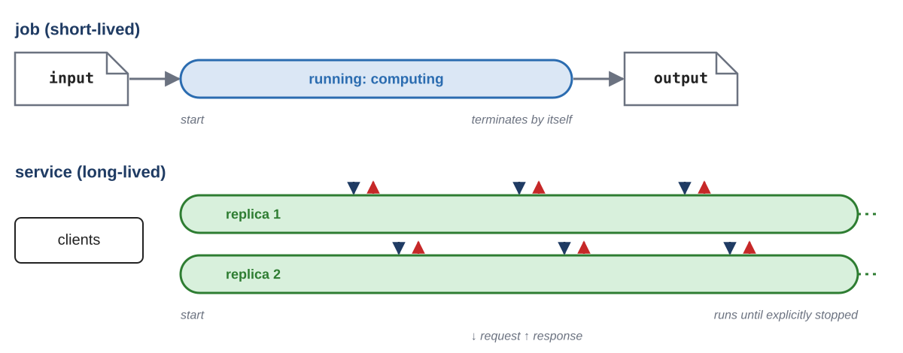

---

## What to deploy? (pt. 2)

### Short-lived tasks

> __Short-lived__ tasks are bare computational activities aimed at __processing/generating__ some data

- Pure __algorithms__ _accepting data_ as input and/or _producing data_ as output. 

- They will eventually reach their natural __termination__ 
    + _without_ requiring external _intervention_
    
- Common workflow:
    1. users _provide_ the _code_ and the _input_ data, 
    2. they _start_ the task, 
    3. they are interested in _getting the output_ data

- __Parallelism__ may be exploited to _speed up_ the computations

---

## What to deploy? (pt. 3)

### Long-lived tasks

> __Long-lived__ are computational activities which are __not meant to terminate__ automatically (unless _explicitly stopped_)

- Infinite _loops_, just _waiting_ for _requests_, and _serving_ them as soon as possible

- __Interactivity__ is a key aspect: 
    + __clients__ _interact_ with the service, 
    + the service __reacts__ to the clients' requests
    + clients may be _humans_ or _other software_ components

- Common workflow:
    + users _provide_ the _code_ and some _deployment-automation_ script
    + they _start_ the task,
    + they are interested in _interacting_ with the service
        * e.g. via the shell, via some GUI, via the browser, etc.

- __Parallelism__ may be exploited to support __replication__
    + e.g. for __fault tolerance__
    + e.g. for __load balancing__
    + e.g. for __scaling__

---

## Execution context of a computational task

Regardless of their life-span, computational tasks may require __computational resources__ of various sorts:

- specific __hardware capabilities__
    + e.g. quick / multi-core CPUs for computation intensive tasks
    + e.g. GPUs for tasks requiring parallelism
    + e.g. primary memory (RAM)
    + e.g. large / quick storage (SSD, HDD, etc.)
    + e.g. fast network connections (e.g. optical fibre)

- specific __operating systems__ (Linux, macOS, Windows, etc.) or specific __architectures__ (x86, ARM, etc.)

- specific __runtime platforms__ (e.g. JVM, Python, .NET etc.)

- specific __infrastructural components__ (e.g. database, reverse proxy, load-balancer, broker, etc.) 

- specific __libraries__ (e.g. CUDA, `numpy`, etc.)

---

## The need for encapsulation (pt. 1)

<!-- > __Encapsulation__ is the __hiding__ of the __implementation details__ of a __component__ from its __clients__.
> Encapsulated components have a clear __interface__ which is the only way to interact with them. -->

> Why can't we simply configure bare-metal machines to host our tasks?

- Need for __multi-tenancy__ (i.e. sharing) on computational resources
    1. one may have _$N$ machines_ and _$M$ applications_...
        + ... and be willing to __decouple__ applications from machines
    2. different software components may have __incompatible__ HW / SW requirements

- Need for __isolation__
    + preventing _spurious interactions_ among different tenants
    + a common requirement in multi-tenant scenarios

- Need to __formalize / control / reproduce__ the _computational environment_ of applications
    + formalisation is a _pre-requisite_ for __automation__
    + automation _enables_ __control__ and __scale__

- Need to __automate deployment__ of applications into __production__ / __testing__ environments
    + this is the immediate _benefit for engineers_

- Need for __flexibility__ (in _re-deployment_), and __scalability__
    + _effort minimisation_ for application __startup__ or __transfer__

---

## The need for encapsulation (pt. 2)

Some abstraction is needed to encapsulate applications, and their computational environment, into a single unit 

> __Encapsulation__ is the __hiding__ of the __implementation details__ of a __component__ from its __clients__.
> Encapsulated components have a clear __interface__ which is the only way to interact with them. 

---



## How to achieve encapsulation? (pt. 1)

* __Virtual machines__ (VM) on top of VM _hypervisors_ (VMH)

* __Containers__ on top of container _engines_ (CE)

---

## How to achieve encapsulation? (pt. 2)

### Virtual machines and hypervisors (VMH)

- VMH run _on/as_ the _OS_ of a bare-metal machine, __abstracting__ HW and SW peculiarities away
    * VM have _virtualised HW_ and SW resources, different from the host's

- VMH may instantiate __multiple VM__ on the _same physical machine_
    * partitioning actual resources ahead of time

- each VM runs __its own OS__, and may host multiple applications
    * in the eyes of the user, the VM is _indistinguishable_ from a bare-metal machine

- VMs may be _paused_, _snapshotted_ (into a file), _resumed_, and possibly _migrated_
    * snapshots are files containing the whole file-system of the VM

- VM are __coarse__-grained __encapsulation__ units
    * they are _heavy_-weight (GBs)
    * they are _slow_ to start, run, migrate, snapshot
    * VM commonly encapsulate _multiple application_-level components
        + database, server, plus all their runtimes and libraries, etc.

- Many industry-ready __technologies__:
    * VMware, VirtualBox, KVM, Xen, Hyper-V, QEMU, Proxmox, etc.

---

## How to achieve encapsulation? (pt. 3)

### Containers and container engines (CE)

- CE run _on_ the _OS_ of a _bare-metal/virtual_ machine, __abstracting__ the runtime, storage, and network environment away
    + the CPU, memory, OS kernel, drivers, and hardware are __not virtualised__

- one may instantiate __multiple containers__ on the same machine
    + sharing the actual resources dynamically (_overbooking_ support)

- each container __shares the OS kernel__ of the host, yet having its own runtime(s), storage, and network facilities
    + in the eyes of the user, the container is a _process_ running on top of a _minimal OS_

- each container is an _instance_ of an __image__, i.e. a _read-only template_ containing deployment instructions 
    + differences w.r.t. that image constitute the _state of the container_ (these can be _snapshotted_ into a file of minimal size)

- containers are __fine__-grained __encapsulation__ units
    + they are _light_-weight (MBs)
    + they are _fast_ to start, run, snapshot
    + they are commonly used to encapsulate _single application_-level components
        * e.g. a database instance, a web-server instance, etc.
        * the final application should consist of _several_, inter-communicating _containers_

- Many industry-ready __technologies__:
    + Docker, LXC, LXD, Podman, etc.

---

## Bare-metal vs. VMs vs. Containers



Containers provide **runtime isolation** _without_ **operating system replication**

---

## Lightweight virtual machines?


---

## Closer to confined processes


---

## Scaling up to the cluster level (pt. 1)

> __Cluster__ $\approx$ a set of _similarly configured_ __machines__ (a.k.a. __nodes__) __interconnected__ via a __network__ in order to let users exploit their __joint__ computational power

- Users may want to __deploy__ their applications on the _cluster_
    + by means of a _single access point_
        + e.g. a Web dashboard, or a CLI

- Deployment shall __allocate__ tasks on the cluster _efficiently_
    + meeting the tasks' _computational requirements_
    + _balancing_ the _load_ among the nodes
    + _matching requirements_ on actual capabilities of nodes

- __Infrastructure-as-a-service__ (IaaS) cloud technologies support deploying tasks on clusters, _as VM_
    + e.g. OpenStack, vSphere, etc.

- __Container orchestrators__ support deploying tasks on clusters, _as containers_
    + e.g. Kubernetes, Docker Swarm, etc.

---

## Scaling up to the cluster level (pt. 2)

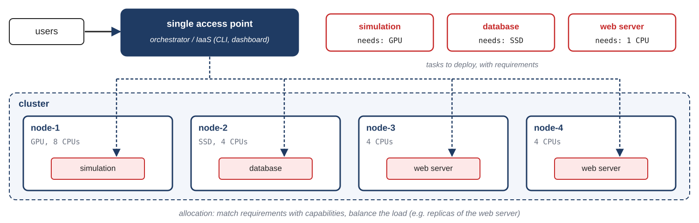

- The access point (e.g. a container orchestrator) decides _where_ each task runs, so users do not have to
- Tasks declare their __requirements__, nodes expose their __capabilities__ (cf. [labelling nodes](#/labelling-nodes) in Swarm)

---

## Why containers? (pt. 1)


{}

{}
{}

{}


---

## Why containers? (pt. 2)

- more fine-grained encapsulation (than VM)
- faster to start, stop, snapshot, migrate (w.r.t. VM)
- more modular, more scalable (than VM)
- useful for dev-ops, and CI/CD
- de-facto standard packaging format for cloud-native deployments (e.g. Kubernetes)

---

## Containerisation vs. Orchestration

- __Containerisation__ $\approx$ the process of _encapsulating_ an application into a _container_

- __Orchestration__ $\approx$ the process of _deploying_ one or more containers onto _one or more_ machines

- __Containerisation__ is a _pre-requisite_ for __orchestration__

- Two syntaxes involved:
    + one to _containerise_ (i.e. create container images)
    + one to _orchestrate_ (i.e. deploy containers)

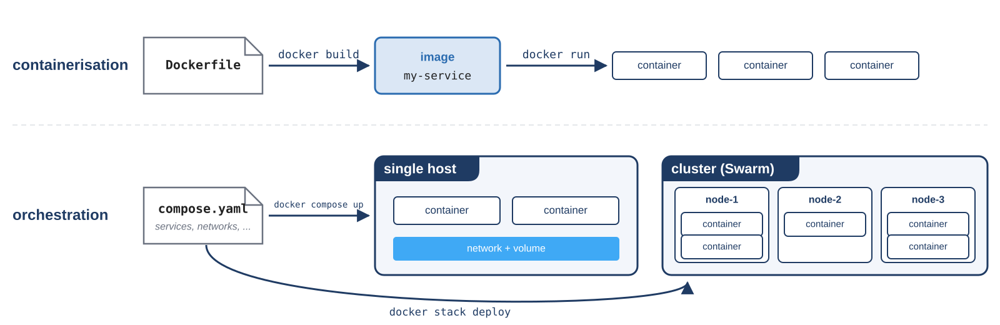

---

## Main abstractions

### Encapsulation level

- __Container__: a sandbox for running a process and its computational environment
- __Image__: a template for creating containers
- __Layer__: a single, cacheable, step in the creation of an image
- __Host__: the machine hosting the containers 
- __Registry__: a repository of images (possibly external w.r.t. the host)
- __Network__: a virtual network for connecting containers (with each other and with the host)
- __Volume__: a bridge for letting containers share data with the host
- __Engine__ (a.k.a. __daemon__): the software running on the host, managing containers, images, volumes, layers, and networks

{}
### Orchestration level

- __Cluster__: a set of machines joined together by the same container orchestrator 
- __Node__: a machine in the cluster (each one acting as a host, and running the container engine)
- __Service__: a set of replicas of the same container
- __Stack__: a set of inter-related services
- __Secret__: sensitive information to be made available on containers (encrypted at rest in Swarm)
{}

---

## Main abstractions (overview)


---



## About technologies

__Docker__: the most famous container technology, actually consisting of several components
- __Docker Engine__: the container engine managing containers and images, locally
- __Docker CLI__: the command line interface for Docker Engine (this is what you use)
- __Docker Desktop__: a GUI for Docker Engine, mostly for inspection purposes (on macOS/Windows it also runs the Engine in a VM)
- __Docker Hub__: the default registry for Docker images, available online
- __Docker Compose__: a tool for orchestrating containers on a single machine
- __Docker Swarm__ (mode): the Engine's built-in support for orchestrating containers on a cluster of machines

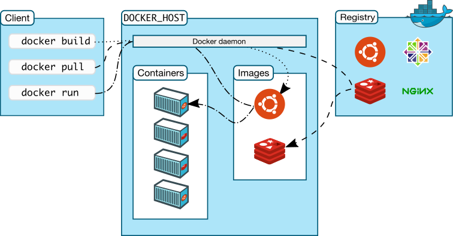

---

## Configure Docker locally

1. Install Docker
    + https://docs.docker.com/engine/install/
    + most commonly available on package managers
2. \[Linux only\] Add your user to the `docker` group
    + `sudo usermod -aG docker $USER`
    + log out and log in again
    + beware: members of the `docker` group are _de facto_ `root` on the host
3. Enable and start the Docker service 
    + on most Linux distributions `sudo systemctl enable docker; sudo systemctl start docker`
    + on macOS and Windows, start the Docker Desktop application
4. Test your installation
    + `docker run hello-world`
5. Explore admissible sub-commands with `docker --help`
    + general command structure `docker <resource> <command> <options> <args>`
        * sometimes, when it's obvious, `<resource>` can be omitted

<br/>

> Subsequent examples are shown on Linux, but they should work on any platform
> + provided that a `bash` or `zsh` shell is available

---

## Running containers

1. Pull an image: `docker pull python:3.14`
2. Run a container: `docker run python:3.14`
    + nothing seems to happen: the container starts and terminates immediately

Every image provides a *default command* (for `python:3.14`, it is the `python3` REPL); running without options runs that default in a *non-interactive* terminal
- the REPL finds no input, hence it terminates

Running in interactive mode can be achieved with the `-i` option
* use the `-t` option to run in a *pseudo-tty* (always use it whenever you use `-i`)
* e.g., `docker run -it python:3.14` opens the Python REPL _inside_ the container

Running a custom command *inside the container* can be achieved by writing the command after the image name
* e.g., `docker run -it python:3.14 bash` opens a shell inside the container
* parameters for the custom command can follow
    + e.g., `docker run python:3.14 python -c "import sys; print(sys.version)"`
* use `--rm` to remove the container after use

---

## Container lifecycle


- `docker ps` lists _running_ containers, `docker ps -a` lists _all_ of them (including _created_ and _exited_ ones)
- `docker start` / `docker stop` / `docker rm` accept container _names_ (cf. `--name`) or _IDs_

---

## Interaction with the outside world

{}
{}
A docker container runs *in isolation*, w.r.t. the host and other containers.

Environment variables, network ports, and file system folders are **not** shared.

Sharing must be explicit and requires options to be specified after `docker run`:

* Passing environment variables: `-e <name>=<value>`
* Mounting volumes: `-v <host>:<guest>:<options>`
    * `<host>` is the path (or volume name) on the host system
    * `<guest>` is the location where it will be mounted on the container
    * `<options>` can be optionally specified as mount options (e.g., `rw`, `ro`)
* Publishing ports: `-p <host>:<guest>`
    * `<host>` is the port on the host system
    * `<guest>` is the corresponding port on the container
{}
{}
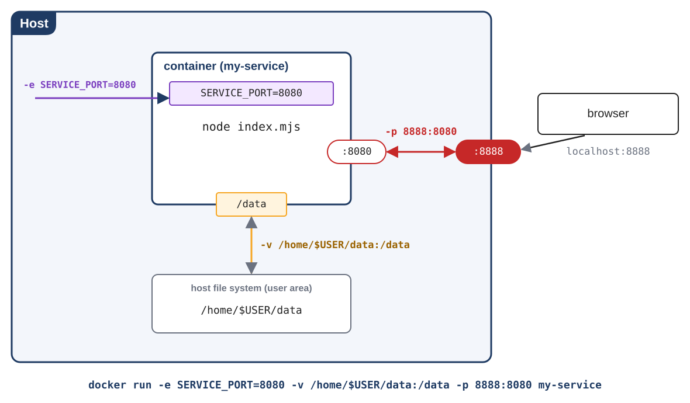
{}
{}

---

## Managing images

Every image has a unique **ID**, and may have an associated **name** (including a **tag**)

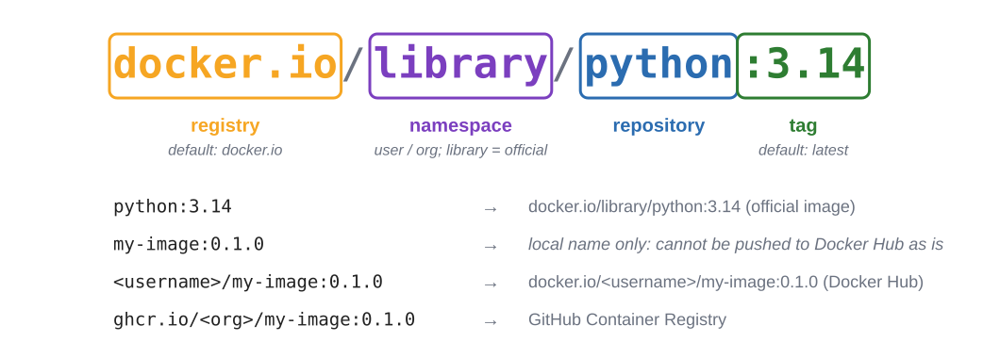

The subcommand `images` lists the pulled images and their associated information

The subcommand `image` allows for running maintenance tasks, e.g.
* `docker image ls` -- same as `docker images`
* `docker image prune` -- removes unused images
* `docker image rm` -- removes images by name
* `docker image tag` -- associates a tag to an image

---



## Creating Docker images

Docker images are written in a `Dockerfile`

- Every _filesystem-changing_ instruction (`RUN`, `COPY`, `ADD`) generates a new *layer*
    + other instructions (`ENV`, `EXPOSE`, `CMD`, ...) only change the image's _metadata_

- The final stack of layers creates the final *image*

- The `docker build` command interprets the `Dockerfile` commands to produce a _sequence of layers_

- Changes to a layer do _not_ invalidate previous layers, but they _do_ invalidate all __subsequent__ ones

---

{}

## Dockerfile syntax

```dockerfile
# Base image, pulled from Docker Hub ("scratch" = empty image)
FROM alpine:latest
# Runs a command
RUN apk add --no-cache nodejs npm
# Sets the working directory (created if missing)
WORKDIR /my-project
# Copies files from the build context into the image: dependencies first...
COPY package.json ./
# ... so this (slow) layer stays cached until package.json changes
RUN npm install
# Copies the rest of the project (relative to the build context)
COPY . .
# Adds a new environment variable
ENV SERVICE_PORT=8080
# Documents the port the service listens on
EXPOSE 8080
# Configures the default command to execute (exec form)
CMD ["npm", "run", "service"]
```

to be built by means of the command: `docker build PATH`
- `PATH` is the host path containing the `Dockerfile` (a.k.a. the __build context__, e.g. `path/to/my/nodejs/project`)

---

## Content of the `path/to/my/nodejs/project` DIRECTORY


{}
1. `Dockerfile` as for the previous slide

2. File `.dockerignore`
```gitignore
node_modules/
```
{}
{}
3. File `package.json`
```json
{
  "name": "example",
  "version": "1.0.0",
  "description": "Example Express WS for Docker",
  "main": "index.mjs",
  "scripts": {
    "service": "node index.mjs"
  },
  "dependencies": {
    "express": "^5.1.0"
  },
  "author": "gciatto",
  "license": "ISC"
}
```
{}
{}
4. File `index.mjs`
```js
import { env } from 'process'
import express from 'express'
import { randomBytes } from 'crypto'

const port = 'SERVICE_PORT' in env ? env.SERVICE_PORT : 8080
const hostname = 'HOSTNAME' in env ? env.HOSTNAME : 'localhost'
// 16-char random string
const serverID = randomBytes(8).toString('hex')

const server = express()

let counter = 0
 
server.get('/', function (req, res) {
  counter++
  res.send(`[${serverID}@${hostname}:${port}] Hit ${counter} times`)
})
 
console.log(`Service ${serverID} listening on ${hostname}:${port}`)
server.listen(port)
```
i.e. a Web service listening on the port indicated by the `SERVICE_PORT` env var, showing Web pages of the form 
```
[$SERVER_ID@$HOST_NAME:PORT] Hit $VIEW_COUNT times
```
{}



{}

---

## Layers and caching (pt. 1)

Every _filesystem-changing_ instruction in a `Dockerfile` generates a *new layer*, the others only set the image _configuration_:

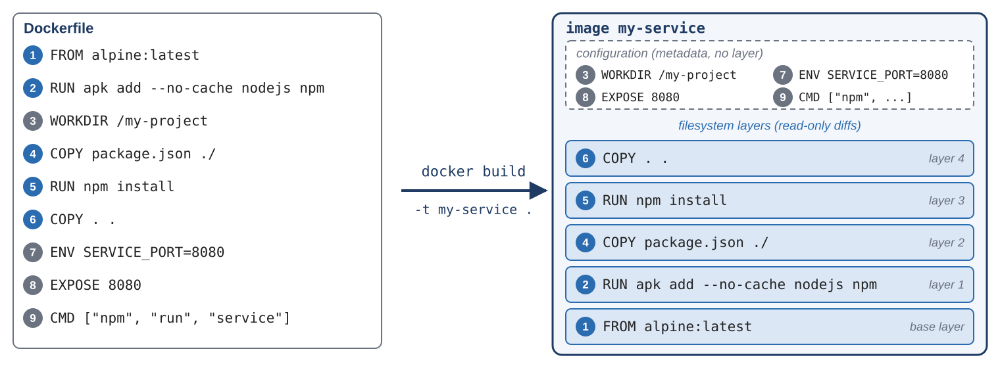

A layer is a *diff* w.r.t. the previous one

In other words, Docker keeps track of what information is added to the image at each step

---

## Layers and caching (pt. 2)

When a `Dockerfile` is built, Docker checks whether each layer is already in the __build cache__
- i.e. same parent layer, same instruction, and (for `COPY`/`ADD`) same file contents

If so, it reuses the __cached layer__, and skips the execution of the corresponding command
- e.g. rebuilding `my-service` after editing `index.mjs` only:

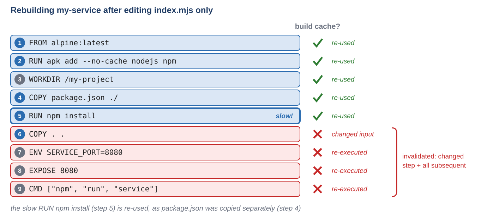

---



## Layers and caching (pt. 3)

What if the `Dockerfile` copied the whole project _before_ installing dependencies?
- i.e. `COPY . .` followed by `RUN npm install`, rather than `COPY package.json ./`, `RUN npm install`, `COPY . .`

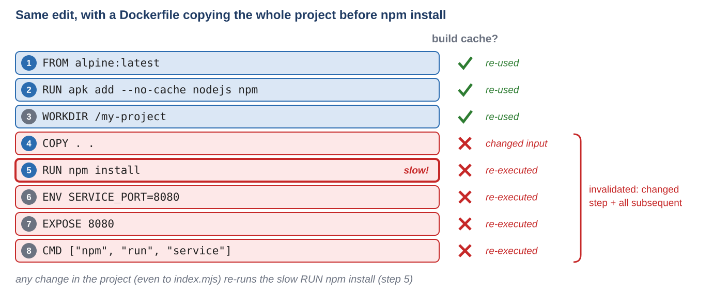

> __Rule of thumb__: order instructions from the _least_ to the _most_ frequently changing, and copy dependency declarations (`package.json`, `requirements.txt`, `build.gradle.kts`, ...) separately from the source code

---

## Layers and caching (pt. 4)

When the container is run, the image layers are *read-only*, and the container has a *read-write* layer on top of them

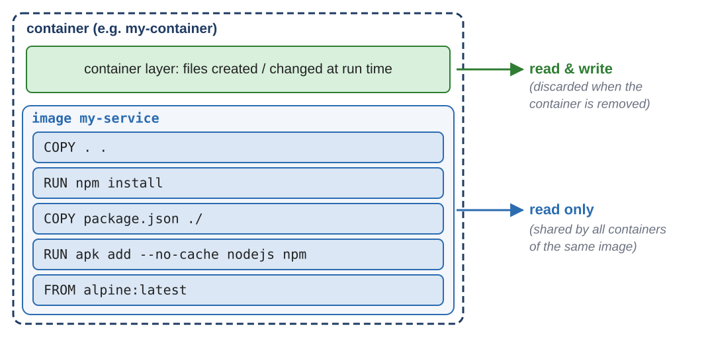

So, when a container is __removed__ (not merely stopped), the read-write layer is discarded, and the image layers are kept

In this way, the _space occupied_ by the container is _minimal_

---

## Naming images

Image naming is done via **tags**

- The easiest way to do so is assigning tags at *build time* with the `-t` option of `docker build`

- The option can be repeated to assign multiple tags (names must be __lowercase__)

    ```bash
    docker build -t "my-image:latest" -t "my-image:0.1.0" path/to/build/context
    ```

- `latest` is usually used to identify the most recent version of some image

- For instance, you may build the image from a few slides ago with:
    * `docker build -t my-service path/to/my/nodejs/project`
        + the image `my-service:latest` is automatically created

---



## Publishing Docker images

Images get published in **registries**

- The most famous, free for publicly available images, is *Docker Hub*

- By default, Docker uses Docker Hub as registry (both for `pull` and `push` operations)

- Docker Hub requires registration and CLI login:
    * `docker login docker.io`

- Once done, publication is performed via `push`, provided that the image name includes your _namespace_:
    * `docker tag my-image:0.1.0 <username>/my-image:0.1.0`
    * `docker push <username>/my-image:0.1.0`

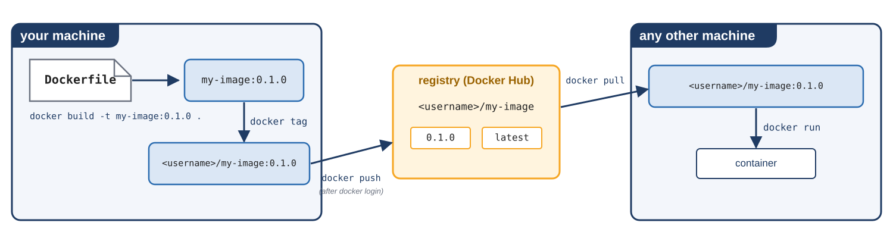

---

## Building Docker images in CI

- Of course, like any other software, *custom docker images should get built in CI*

- Several integrators use _containers_ as __build environments__: 
    * it is possible to *build a container using a container*

- More generally: there is *no inherent limit to nesting containers*

- For instance:
    * you may run DIND (Docker-in-Docker) via: `docker run --privileged --rm -it docker:dind`
    * you may use the Docker CLI in a container: `docker run -it --rm docker:cli`

---



## Volumes

Volumes are *bridges* between the _host's_ __file system__ (or memory) and the _container's_ one



They support several use cases:
- __sharing__ data between the host and the container
- __persisting__ containers' data
- sharing data among containers

---

## Sorts of volumes (pt. 1)

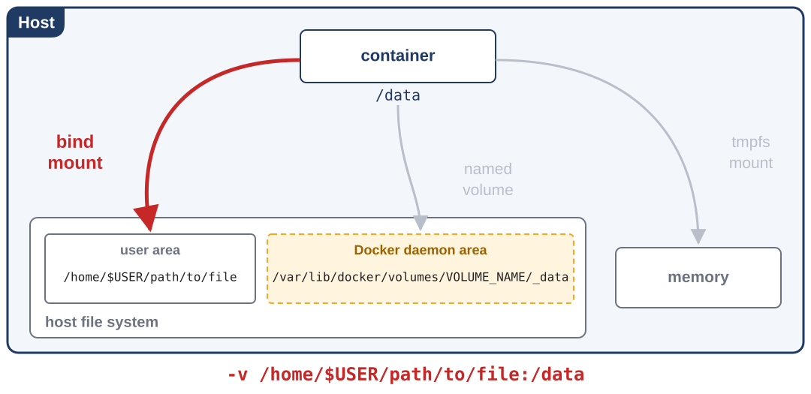

- __Bind mount__: a host directory is __mounted__ into the container
    + the host directory is specified as `<host path>:<guest path>` (use __absolute paths__, e.g. via `$(pwd)`)
        + e.g. `docker run -v /home/$USER/path/to/file:/data ...`
    + data present in `<host path>` can be read within the container at `<guest path>`
    + data written within the container at `<guest path>` can be accessed on `<host path>`
        * even after the container is stopped / deleted

---

## Sorts of volumes (pt. 2)

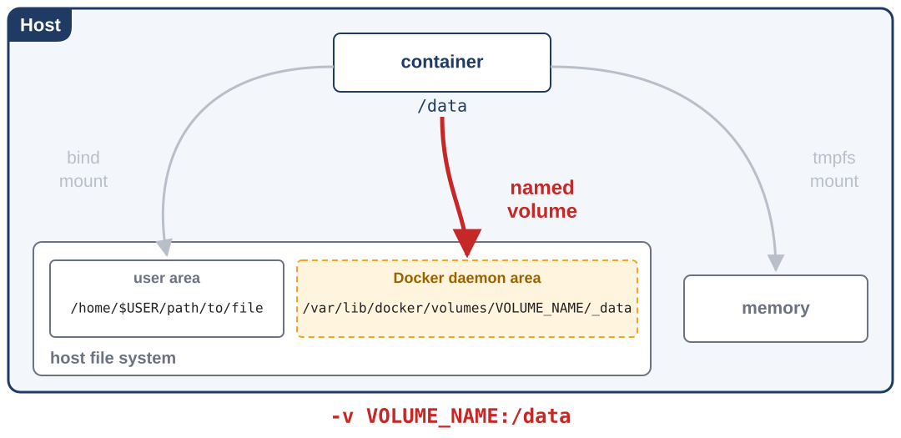

- __Named volumes__: virtual drives managed by Docker
    + they are created with `docker volume create <name>`
    + they are mounted into containers as `<name>:<guest path>`
    + their content's life span is independent of any container
    + they can be attached to containers at run-time, referencing their name:
        * e.g. `docker run -v my-volume:/my-project ...`
    + technically, they are just directories on the host's file system, yet handled by Docker
        * `/var/lib/docker/volumes/<name>/_data`
        * on Docker Desktop, this path is inside the Engine's VM

---

## Sorts of volumes (pt. 3)

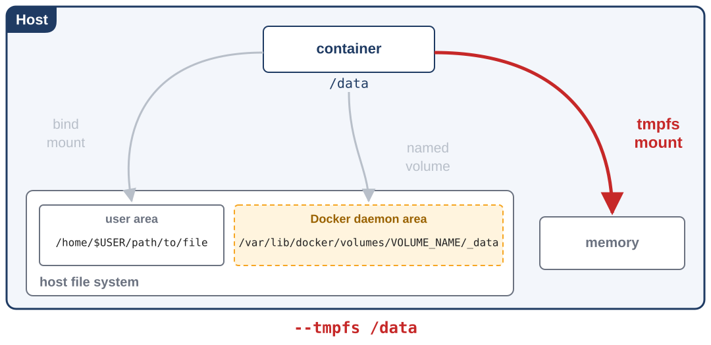

- __Tmpfs mount__ [Linux-only]: a temporary file system, living only as long as the container is alive
    + it is useful for storing temporary data
    + do not use it for sharing or persisting data
    + it is like an anonymous, ephemeral named volume
    + created by means of a `--tmpfs` option to `docker run`
        * e.g. `docker run --tmpfs <guest path> ...`
        * or `docker run --mount type=tmpfs,destination=<guest path> ...`

---

## Volumes in practice

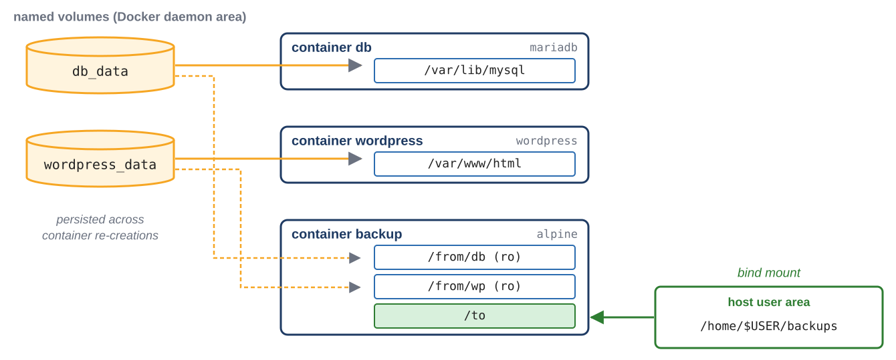

- Named volumes `db_data` and `wordpress_data` __persist__ the data of the `db` and `wordpress` containers
    + cf. the WordPress stack in the [Docker Compose part](#/compose), where Compose prefixes their names with the project name
- The same volumes can be __shared__ with other containers, e.g. a one-shot `backup` container mounting them read-only...
- ... and __sharing__ results with the host via a bind mount:
    ```bash
    docker run --rm \
        -v db_data:/from/db:ro \
        -v wordpress_data:/from/wp:ro \
        -v /home/$USER/backups:/to \
        alpine tar czf /to/backup.tar.gz -C / from
    ```

---

## Example: containers' data is ephemeral

1. Let's open a Linux shell in a container: `docker run -it --rm alpine:latest sh`

2. Let's create a folder in there: `mkdir -p /data`

3. Let's create a file in there: `echo "Hello world" > /data/hello.txt`

4. Does the file exist? `ls -la /data`
    ```
    / # ls -la /data
    total 12
    drwxr-xr-x    2 root     root          4096 Nov  2 09:28 .
    drwxr-xr-x    1 root     root          4096 Nov  2 09:28 ..
    -rw-r--r--    1 root     root            12 Nov  2 09:28 hello.txt
    ```

5. Let's exit the container: `exit`

6. Let's open a new shell in a new container: `docker run -it --rm alpine:latest sh`

7. Does the file exist? `ls -la /data`
    ```
    ls: /data: No such file or directory
    ```

8. Why?
    + the second `docker run ...` command created a new container

---

## Example: sharing data with bind mounts (pt. 1)

1. Let's create a folder on the host: `mkdir -p $(pwd)/shared`

2. Let's create 10 containers
    1. each one creating a file in `./shared/`
    2. named `container-<i>.txt`
    3. containing random data from `/dev/random`, encoded in base64
    4. in _detached_ mode (`-d`), with a _bind mount_ (`-v`), and a parametric _hostname_ (`--hostname`)

    ```bash
    for i in $(seq 1 10); do
        docker run --rm -d \
            -v $(pwd)/shared:/data \
            --hostname container-$i \
            alpine sh -c \
            'cat /dev/random | head -n 1 | base64 > /data/$(hostname).txt'
    done
    ```

3. Let's have a look at the shared directory: `ls -la ./shared`
    ```
    ls -la ./shared 
    totale 56
    drwxr-xr-x  2 user    user     4096  2 nov 10.51 .
    drwxr-xr-x 79 user    user    12288  2 nov 10.56 ..
    -rw-r--r--  1 root    root      329  2 nov 10.51 container-10.txt
    -rw-r--r--  1 root    root      333  2 nov 10.51 container-1.txt
    -rw-r--r--  1 root    root      381  2 nov 10.51 container-2.txt
    -rw-r--r--  1 root    root      167  2 nov 10.51 container-3.txt
    -rw-r--r--  1 root    root      110  2 nov 10.51 container-4.txt
    -rw-r--r--  1 root    root      102  2 nov 10.51 container-5.txt
    -rw-r--r--  1 root    root        9  2 nov 10.51 container-6.txt
    -rw-r--r--  1 root    root      106  2 nov 10.51 container-7.txt
    -rw-r--r--  1 root    root      766  2 nov 10.51 container-8.txt
    -rw-r--r--  1 root    root      203  2 nov 10.51 container-9.txt
    ```

---



## Example: sharing data with bind mounts (pt. 2)

4. Things to notice:
    + the files are owned by `root` (inside the container)
    + the files are still owned by `root` on the host (outside the container)
        * despite the fact that the host user is `user`
        * if `user` has no superuser privileges, they cannot _edit_ the files
            - they can still _delete_ them, as `./shared` is owned by `user`
        * (on Docker Desktop, the VM may map ownership to the host user instead)
    + when creating the container, bind mounts should be __absolute__ paths
        * hence the need for `$(pwd)` to get the current working directory

---

## Example: sharing data with named volumes (pt. 1)

1. Let's create a named volume: `docker volume create my-volume`

2. Same 10 containers as before, but using the named volume (`-v my-volume:/data`) instead of the bind mount

    ```bash
    for i in $(seq 1 10); do
        docker run --rm -d \
            -v my-volume:/data \
            --hostname container-$i \
            alpine sh -c \
            'cat /dev/random | head -n 1 | base64 > /data/$(hostname).txt'
    done
    ```

3. How to access the data now?
    1. by means of another container, attached to the same volume
    2. by means of the host, inspecting the volume's file system

---

## Example: sharing data with named volumes (pt. 2)

### Accessing the volume from another container

1. Let's create yet another _interactive_ container attached to the volume
    * `docker run --rm -it -v my-volume:/data alpine sh`
2. Let's have a look at the data: `ls -la /data`
    ```
    total 48
    drwxr-xr-x    2 root     root          4096 Nov  2 10:15 .
    drwxr-xr-x    1 root     root          4096 Nov  2 10:15 ..
    -rw-r--r--    1 root     root           608 Nov  2 10:14 container-1.txt
    -rw-r--r--    1 root     root           349 Nov  2 10:15 container-10.txt
    -rw-r--r--    1 root     root           369 Nov  2 10:14 container-2.txt
    -rw-r--r--    1 root     root           304 Nov  2 10:14 container-3.txt
    -rw-r--r--    1 root     root           240 Nov  2 10:14 container-4.txt
    -rw-r--r--    1 root     root           434 Nov  2 10:14 container-5.txt
    -rw-r--r--    1 root     root           150 Nov  2 10:14 container-6.txt
    -rw-r--r--    1 root     root            41 Nov  2 10:14 container-7.txt
    -rw-r--r--    1 root     root            33 Nov  2 10:15 container-8.txt
    -rw-r--r--    1 root     root          1212 Nov  2 10:15 container-9.txt
    ```

---

## Example: sharing data with named volumes (pt. 3)

### Accessing the volume from the host

3. Alternatively, let's find where the volume is stored on the host
    * `docker volume inspect my-volume`

4. Let's analyse the JSON description of the volume:
    ```json
    [
        {
            "CreatedAt": "2023-11-02T11:13:56+01:00",
            "Driver": "local",
            "Labels": null,
            "Mountpoint": "/var/lib/docker/volumes/my-volume/_data",
            "Name": "my-volume",
            "Options": null,
            "Scope": "local"
        }
    ]
    ```

---

## Example: sharing data with named volumes (pt. 4)

### Accessing the volume from the host

5. The `Mountpoint` entry reveals the location of the volume on the host's file system

6. Let's look into that position (may require _super-user_ access rights, Linux only):
    * `sudo ls -la /var/lib/docker/volumes/my-volume/_data`
    
        ```
        totale 48
        drwxr-xr-x 2 root root 4096  2 nov 11.15 .
        drwx-----x 3 root root 4096  2 nov 11.13 ..
        -rw-r--r-- 1 root root  349  2 nov 11.15 container-10.txt
        -rw-r--r-- 1 root root  608  2 nov 11.14 container-1.txt
        -rw-r--r-- 1 root root  369  2 nov 11.14 container-2.txt
        -rw-r--r-- 1 root root  304  2 nov 11.14 container-3.txt
        -rw-r--r-- 1 root root  240  2 nov 11.14 container-4.txt
        -rw-r--r-- 1 root root  434  2 nov 11.14 container-5.txt
        -rw-r--r-- 1 root root  150  2 nov 11.14 container-6.txt
        -rw-r--r-- 1 root root   41  2 nov 11.14 container-7.txt
        -rw-r--r-- 1 root root   33  2 nov 11.15 container-8.txt
        -rw-r--r-- 1 root root 1212  2 nov 11.15 container-9.txt
        ```

---

## How to reclaim space from a volume?

Volumes are NOT automatically _cleaned up_ when containers are _deleted_

- Volumes must be __explicitly__ deleted by the user
    * `docker volume rm <volume name>`

- In our example, remember to delete `my-volume`:
    * `docker volume rm my-volume`
        + beware: this will delete all the data in the volume!

---

## Sudo-powered containers (pt. 1)

- Sometimes one may want to let a container access the _Docker daemon_ __of its host__
    * this is useful for running containers that will: _create/delete_ other containers, handle images, etc.

- To achieve that one may exploit __bind mounts__
    * to share the Docker daemon's socket with the container

- Explanation:
    * on the host, the Docker daemon is just a _service_ listening for commands on a [Unix socket](https://en.wikipedia.org/wiki/Unix_domain_socket)
    * the socket is usually reified as a _file_ on the host's file system, at `/var/run/docker.sock`
    * the `docker` command is just a CLI program writing/reading to/from the socket to govern the daemon

- One may simply create a Docker container with the Docker CLI tool installed on it
    * and share the host's Docker socket with that container via a bind mount
        + `docker run -it --rm -v /var/run/docker.sock:/var/run/docker.sock --name sudo docker:cli sh`

- Inside that container one may run the `docker` command as usual, to govern the host's Docker daemon
    * e.g. `docker ps`

    ```
    CONTAINER ID   IMAGE        COMMAND                  CREATED          STATUS          PORTS      NAMES
    3d9016cd067e   docker:cli   "docker-entrypoint.s…"   5 seconds ago    Up 3 seconds               sudo
    ```

---

## Sudo-powered containers (pt. 2)

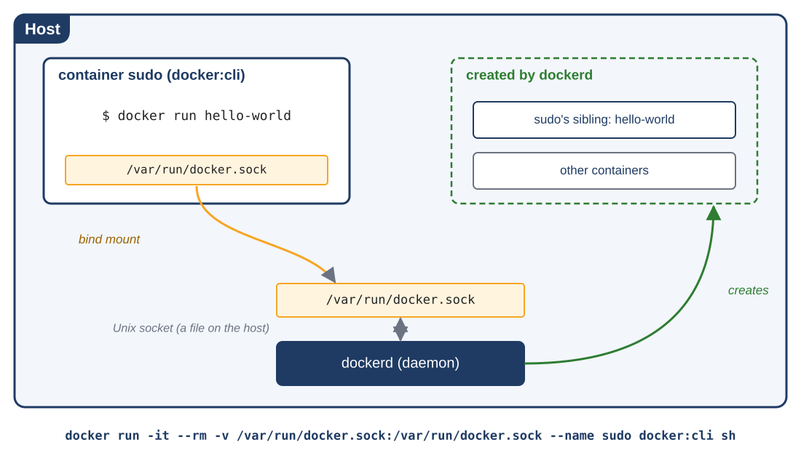

- Containers created from _within_ `sudo` are __siblings__ of `sudo` on the host, not nested inside it
    + e.g. bind mounts are resolved against the _host's_ file system, not against `sudo`'s one
- Beware: whoever controls the socket controls the host (same as being in the `docker` group)

---



## Networks

Docker may virtualise container's __networking facilities__
1. network interfaces
2. IP addresses
3. layer-4 ports

<br/>

This is useful to let containers __communicate__ with any external entity
<br/>most commonly, other containers or the host

{}
<br/>

> __Networks__ are virtual entities managed by Docker
> - they mimic the notion of _layer-3 network_
> - in the eyes of the single container, they are _virtual network interfaces_
> - overall, their purpose is to _delimit_ the __communication scope__ for containers
{}

---

## Sorts of networks (pt. 1)

Different sorts of networks are available in Docker, depending on the __driver__:

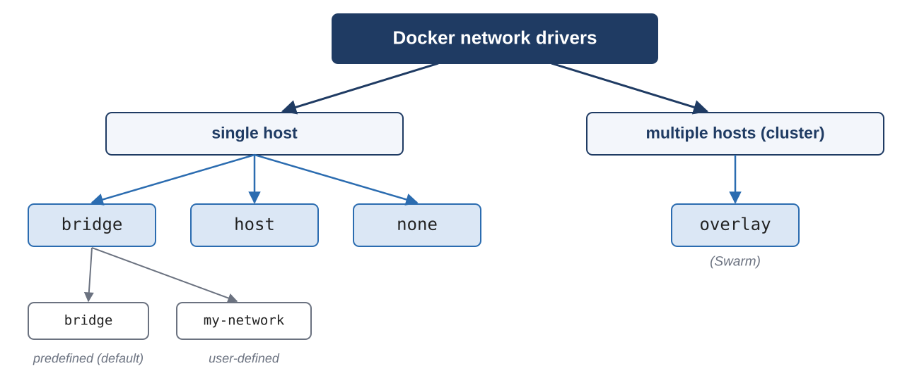

---

## Sorts of networks (pt. 2)

Available drivers:
- __none__: no networking facilities are provided to the container, which is then isolated

- __host__: remove network isolation between the container and the Docker host, and use the host's networking directly

- __bridge__ (default): a virtual network, internal to the host, letting multiple containers communicate with each other

- __overlay__: a virtual network, spanning multiple hosts, letting multiple containers communicate with each other among different nodes of the same cluster

<br/>

Other drivers are available as well, cf. https://docs.docker.com/engine/network/drivers/

---

### None network driver



- __No__ networking facilities are provided to the container __at all__, which is then _isolated_ w.r.t. the external world

- This is useful for containers that do not need to communicate via the network
    + i.e. they _expose no service_, and they __must not access__ the Internet
        * very rare situation

- Example: `docker run --network none -it --rm alpine sh`
    ```bash
    / # ping 8.8.8.8
    PING 8.8.8.8 (8.8.8.8): 56 data bytes
    ping: sendto: Network unreachable
    ```

---

### Host driver



- __No isolation__ between the container and the host
    + the container uses the host's networking facilities _directly_

- The main consequence is that the container will be assigned the __same IP address as the host__
    + the layer-4 ports used by the container are __also busy__ for the host
        * high __collision__ probability

- Example (Linux hosts; Docker Desktop supports it only in recent versions, as an opt-in): `docker run --network host my-service`
    ```
    Service 540c3b7bb7860c6a listening on <your pc's hostname>:8080
    ```

    * try now to start a service on port 8080 on your host
        + you should get an error message stating that port 8080 is already in use

---

## Bridge network (pt. 1)



- __Virtual network__ spanning _one or more containers_ on the _same host_
    + containers attached to the _same_ network can __communicate__ with each other via _TCP/IP_
    + each container may be attached to __multiple networks__
        * e.g. one for internal communication, one for external communication

- Each container gets assigned a __private IP address__ on the network
    + commonly in the range `172.x.y.z`
    + the IP address is contactable from the host (Linux only: on Docker Desktop, containers live in a VM)

---

## Bridge network (pt. 2)

To exemplify the usage of IP:

1. let's create a container using the `my-service` image created a few slides ago
    * `docker run --network bridge -d --rm --name my-container my-service`
    * this should be a service listening on port `8080`
    * we call the container `my-container`
    * specifying `--network bridge` is useless, because that's the default

2. let's inspect the container's IP address
    * `docker inspect my-container | grep IPAddress`
        + at the time of writing, the IP address is `172.17.0.2`

3. open your browser and browse to `http://172.17.0.2:8080` (on Linux)
    * you should see a page of the form: `[$SERVER_ID@$HOST_NAME:PORT] Hit $VIEW_COUNT times`
    * the page is served by the container, contacted by IP
    * so containers attached to `bridge`-like networks can be contacted by IP, from the host

4. try to contact the container:
    * by host name, from the host
        + this should not work $\Rightarrow$ no host-specific DNS resolution for containers
    * by IP, from another host (in the same LAN of the host)
        + this should not work $\Rightarrow$ _bridge_ networks are host specific

---

## Bridge network (pt. 3)

Let's create a non-trivial scenario with 2 containers attached to the same network:
1. one container (host name: `dind`) will run the Docker daemon (Docker-in-Docker)
2. the other container (host name: `cli`) will run the Docker CLI
3. let's call the shared network `my-network`

---

## Bridge network (pt. 4)

1. let's create the network: `docker network create --driver bridge my-network`
    * a random string is returned: that's the network's ID

2. let's create the daemon: 
    * `docker run --privileged -d --rm --network my-network --hostname dind docker:dind`

3. let's create the client: `docker run -it --rm --network my-network --hostname cli docker:cli`
    1. inside `cli`, let's check if `dind` is contactable by hostname: `ping dind`
        * this should work $\Rightarrow$ networks come with their own __name resolution__ support
    2. inside `cli`, let's check if the Docker client works: `docker ps`
        ```
        error during connect: Get "http://docker:2375/v1.24/containers/json": dial tcp: lookup docker on 127.0.0.11:53: no such host
        ```
    
    3. apparently the `docker:cli` image is preconfigured to contact a daemon on the `docker` hostname

4. let's stop `dind`:
    - you can use `docker ps` on the host to get the name of the `dind` container
    - then `docker stop <container name>`
    - or `docker stop $(docker ps -q --filter ancestor=docker:dind)`
        + `-q` (_quiet_), only display container IDs
        + `--filter ancestor=X` selects containers whose image is `X`
    - next time let's give an explicit name to the container via `--name`

---

## Bridge network (pt. 5)

5. let's restart a Docker-in-Docker daemon, using the `docker` hostname:
    * `docker run --privileged -d --rm --network my-network --name dind --hostname docker docker:dind dockerd --host=tcp://0.0.0.0:2375`
    * in general, it would be better to specify both `--name X` and `--hostname X`
        + same name and hostname to avoid confusion!
    * `dockerd --host=tcp://0.0.0.0:2375` is necessary to force the port the daemon will listen on
        + and to disable TLS security (not recommended in production)

6. let's restart the client: `docker run -it --rm --network my-network --hostname cli docker:cli`

7. let's run a command on the CLI, say `docker run hello-world`
    * this should work $\Rightarrow$ the client is now able to contact the daemon via the `docker` hostname

---

## Overlay network

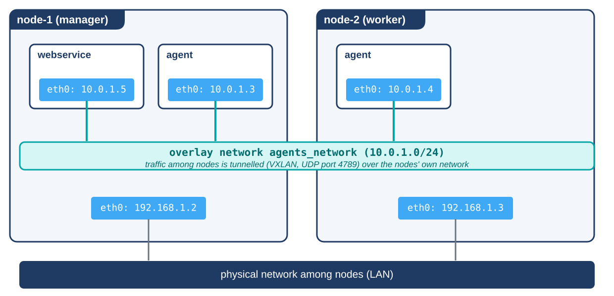

- __Virtual network__ spanning _multiple hosts_, i.e. the nodes of a [Swarm](#/swarm) cluster
    + containers attached to it communicate as if they were on the same host, regardless of the node they run on
    + traffic among nodes is _encapsulated_ ([VXLAN](https://en.wikipedia.org/wiki/Virtual_Extensible_LAN)) over the network the nodes are attached to
- E.g. the `agents_network` network of the [Portainer stack](#/portainer), later in this lecture
    + created via `docker network create --driver overlay --attachable my-overlay` on a manager, or declared in a stack file

---

## Exposing ports (pt. 1)

- When a container wraps a __service__ listening on __layer-4 port__...
    + ... the port is __not accessible__ from the _outside_ world
    + ... unless it is __explicitly published__ when running the container

- When _creating_ a Docker _image_, the `EXPOSE` command in the `Dockerfile` is used to _declare_ which ports the service listens on
    + e.g. `EXPOSE 8080`
    + this is just _documentation_ (metadata): it does __not__ publish the port

- The port exposed by a container can be inspected via `docker ps`
    + e.g. `docker run -d --rm my-service; docker ps`
    ```
    CONTAINER ID   IMAGE        COMMAND                  CREATED        STATUS                  PORTS      NAMES
    7a14f3bf95cc   my-service   "/bin/sh -c 'npm run…"   1 second ago   Up Less than a second   8080/tcp   wonderful_goldwasser
    ```

    (look at the `PORTS` column)

---

## Exposing ports (pt. 2)

- When _running_ a Docker _container_, the exposed port can be mapped to the host's ports via the `-P` option
    + this would make any `EXPOSE`d port in the image mapped to some _random_ port of the host
    + e.g. `docker run -d --rm -P my-service; docker ps`
    + to discover the actual port mapping, run `docker ps`

    ```
    CONTAINER ID   IMAGE        COMMAND                  CREATED         STATUS         PORTS                                         NAMES
    b1470831b62b   my-service   "/bin/sh -c 'npm run…"   6 seconds ago   Up 5 seconds   0.0.0.0:32773->8080/tcp, :::32773->8080/tcp   sad_benz
    ```

- One may control the mapping of ports via the `-p <host port>:<guest port>` option
    + e.g. `docker run -d --rm -p 8888:8080 my-service; docker ps`
    + this would map the container's port `8080` to the host's port `8888`

    ```
    CONTAINER ID   IMAGE        COMMAND                  CREATED         STATUS         PORTS                                       NAMES
    f034da93c476   my-service   "/bin/sh -c 'npm run…"   4 seconds ago   Up 3 seconds   0.0.0.0:8888->8080/tcp, :::8888->8080/tcp   bold_booth
    ```

---

## Exposing ports (pt. 3)

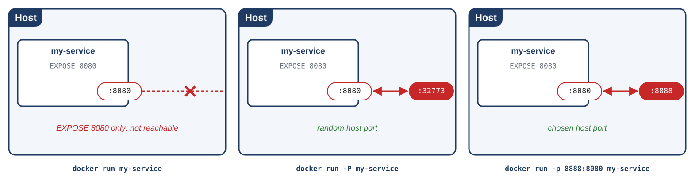

- `EXPOSE` only _documents_ the port: it is __publishing__ (`-P` or `-p`) that makes it reachable from outside the host
- `-p` also accepts an IP to bind to, e.g. `-p 127.0.0.1:8888:8080` publishes the port on the loopback interface only

---



# Orchestration

## With Docker Compose

---

## Do we need orchestration?

> Operating containers manually is error prone and low-level

- Docker Compose lets you increase the __abstraction level__ on the __single machine__

- Starting from a __user-provided specification__ of a __stack__...
    + i.e. a set of containers, their images, their environment, their dependencies

- ... Docker Compose can:
    + __orderly start__ the containers up
    + while _creating_ all required _networks_ and _volumes_
    + and __gracefully shut__ them __down__ upon need

- The only thing the user must do is create a `compose.yaml` file
    + a [YAML](https://yaml.org/) file describing the stack
    + following the [official specification](https://docs.docker.com/reference/compose-file/)
    + `compose.yaml` is the preferred file name nowadays, `docker-compose.yml` is still supported
    + the top-level `version` attribute is _obsolete_, hence omitted in what follows

---

## Docker Compose syntax by example (pt. 1)



The example application is composed of the following parts:

- 2 services, backed by Docker images: `webapp` and `database`
- 1 secret (HTTPS certificate), injected into the frontend
- 1 secret (DB credentials), injected into both services
- 1 configuration (HTTP), injected into the frontend
- 1 persistent volume, attached to the backend
- 2 networks

---

## Docker Compose syntax by example (pt. 2)



{}
```yaml
services:                       # section defining services composing the stack
  frontend:                     # name of the first service (frontend)
    image: example/webapp       # image to use for the first service
    depends_on:                 # section for dependencies
       - backend                # short-form depends_on waits for start, not for health
    environment:                # section for environment variables
      SERVICE_PORT: 8043        # port the service will listen on
      DB_HOST: backend          # hostname of the backend service (= service name)
      DB_PORT: 3306             # port the backend service will listen on
    ports:                      # section for ports published on the host
      - "443:8043"              # container port 8043 as host port 443
    networks:                   # section for networks to be attached to
      - front-tier              # attach to front-tier network (by name)
      - back-tier               # attach to back-tier network (by name)
    # configs are files copied into the container, with no need to build a new image
    configs:                    # section for config files to be injected
      - source: httpd-config    # reference to the configuration file (by name)
        target: /etc/httpd.conf # where the config is mounted (read-only)
    # secrets are reified as read-only files in /run/secrets/<secret_name>
    secrets:                    # section for secrets to be injected
      - server-certificate      # reference to the secret (by name)
      - db-credentials          # reference to the secret (by name)
    
      # assumption: image example/webapp is programmed to load secrets
      # from /run/secrets/<secret_name>

  backend:                      # name of the second service (backend)
    image: example/database     # image to use for the second service
    # command run inside the container to check whether it is healthy
    healthcheck:
      test: ["CMD", "command", "which", "should", "fail", "if", "db not healthy"]
      interval: 1m30s
      timeout: 10s
      retries: 3
      start_period: 40s
    volumes:                    # section for volumes to be attached to the container
      - db-data:/etc/data       # the volume db-data (reference by name) will be mounted 
                                # as read-write in /etc/data
    networks:
      - back-tier               # attach to back-tier network (by name)
    secrets:
      - db-credentials          # reference to the secret (by name)
```
{}
{}
```yaml
volumes:                   # section for volumes to be created in the stack
  db-data:                 # name of the volume, to be referenced by services
    driver_opts:
      type: "none"
      o: "bind"            # this volume is a bind mount
      device: "/path/to/db/data/on/the/host"

configs:                   # section for configuration files to be created in the stack
  httpd-config:            # name of the configuration file, to be referenced by services
    file: path/to/http/configuration/file/on/the/host

secrets:                   # section for secrets to be created in the stack
  server-certificate:      # name of the secret, to be referenced by services
    file: path/to/certificate/file/on/the/host
  db-credentials:          # name of the secret, to be referenced by services
    external: true         # not created by the stack, but expected to exist
    name: my-db-creds      # name of the secret, as created by the user 

networks:
  # The presence of these objects is sufficient to define them
  front-tier: {}
  back-tier: {}
```
{}


---

## Orchestration-level notions (pt. 1)

### Stacks

A __stack__ is a set of _inter-related_ services, networks, volumes, secrets, configs
- all of which are defined in a single `compose.yaml` file
- all of which are created / deleted / updated / started / stopped __together__

### Services

From [Docker Compose documentation](https://docs.docker.com/reference/compose-file/services/):
- a __service__ is an _abstract definition_ of a computing resource within an _application_ which can be __scaled__ or __replaced__ independently of other components
- they are backed by a _set of_ __containers__, run by the orchestrator according to __replication requirements__ and __placement constraints__
- they are backed by containers, hence they are defined by an __image__ and a set of __runtime arguments__
    + all containers within a service are _identically_ created with these arguments
- they are declared in the `services` section of the `compose.yaml` file
    + for each service, _attributes_ may be specified, _overriding_ the default behaviour of the image
    + further attributes may be specified to declare _dependencies_ on other services, volumes, networks, and so on
        * these must be declared in the same `compose.yaml` file

---

## Orchestration-level notions (pt. 2)

### Configs

From [Docker Compose documentation](https://docs.docker.com/reference/compose-file/configs/):
- __configs__ are _files_ containing _configuration data_ that can be _injected_ into services upon instantiation
- they allow users to configure their services' behaviour _without_ the need to __(re)build a (new) image__
- they are _read-only_ files, mounted into services' containers, similarly to _read-only_ __volumes__
- they are declared in the `configs` section of the `compose.yaml` file

---

## Orchestration-level notions (pt. 3)

### Configs

- one config may either be created __stack-wise__ out of a __local file__ from the _host_...
    ```yaml
    configs:
        config_name:
            file: /path/to/config/on/the/host
    ```
- ... or (__Swarm mode only__) it can be __manually created__ by means of the `docker config create [OPTIONS] NAME PATH` command
    + in this case they can be referenced in several `compose.yaml` files:
        ```yaml
        configs:
            config_name:
                external: true
                name: "the name used when creating the config"
                # this may be different from config_name
        ```

- in any case, the config's mount point should be specified at the service level:
    ```yaml
    services:
        my-service:
            ...
            configs:
                - source: config_name # reference to the configs section (by YAML name)
                  target: /path/to/config/on/the/container
    ```

---

## Orchestration-level notions (pt. 4)

### Secrets

From [Docker Compose documentation](https://docs.docker.com/reference/compose-file/secrets/):
- __secrets__ are configs containing sensitive data that should be _kept secret_
- put simply, Docker makes it harder to inspect the content of secrets, both on the host and inside the container
    + in Swarm mode, secrets are _encrypted_ at rest and in transit
    + with plain Docker Compose, they are just _bind-mounted_ files (no encryption)
- one secret may either be created __stack-wise__ out of a __local file__ or an __environment variable__ from the _host_...

{}
```yaml
secrets:
    secret_name:
        file: "/path/to/secret/on/the/host"
```
{}
{}
```yaml
secrets:
    secret_name:
        environment: "NAME_OF_THE_VARIABLE_ON_THE_HOST"
```
{}

- ... or (__Swarm mode only__) it can be __manually created__ by means of the `docker secret create [OPTIONS] NAME PATH|-` command
    + in this case they can be referenced in several `compose.yaml` files:
        ```yaml
        secrets:
            secret_name:
                external: true
                name: "the name used when creating the secret"
                # this may be different from secret_name
        ```

- in any case, the secret's mount point should be specified at the service level:
    ```yaml
    services:
        my-service:
            ...
            secrets:
                # short syntax, mounted on /run/secrets/<secret_name>
                - secret_name # reference to the secrets section (by YAML name)
                # long syntax
                - source: secret_name # reference to the secrets section (by YAML name)
                  target: /path/to/secret/on/the/container
    ```

---

## Orchestration-level notions (pt. 5)

### About secrets and configs

Important remark:
- in the eyes of the container, secrets and configs are just _read-only files_ mounted on some `PATH`
- the containerised application is responsible for reading the secrets / configs from the mounted `PATH`
- when __using__ _somebody else's image_, you may _expect_ the image to be programmed to read secrets / configs from __customisable paths__
- when __creating__ your own image, you _should_ make the application able to read secrets / configs from __customisable paths__
    + e.g. via environment variables

---

## Orchestration-level notions (pt. 6)

### Volumes

From [Docker Compose documentation](https://docs.docker.com/reference/compose-file/volumes/):
- volumes in compose are no different from the ones we have already discussed
- they are declared in the `volumes` section of the `compose.yaml` file
- one volume may be created __stack-wise__ out of a __local folder__ from the _host_...
    ```yaml
    volumes:
        volume_name:
            driver: local
            driver_opts:
                type: "none"
                o: "bind"
                device: "/path/to/folder/on/the/host"
    ```
- ... or maybe some remote folder exposed by some [NFS](https://en.wikipedia.org/wiki/Network_File_System) service on the network
    ```yaml
    volumes:
        volume_name:
            driver: local
            driver_opts:
                type: "nfs"
                # meaning of options: https://wiki.archlinux.org/title/NFS#Mount_using_/etc/fstab
                o: "addr=NFS_SERVER_ADDRESS,nolock,soft,rw" # cf. nfs
                device: ":/path/on/the/nfs/server/"
    ```

---

## Orchestration-level notions (pt. 7)

### Volumes (cont'd)

- ... or it can be __manually created__ by means of the `docker volume create [OPTIONS] NAME` command
    + in this case they can be referenced in several `compose.yaml` files:
        ```yaml
        volumes:
            volume_name:
                external: true
                name: "the name used when creating the volume"
                # this may be different from volume_name
        ```

- in any case, the volume's mount point should be specified at the service level:
    ```yaml
    services:
        my-service:
            ...
            volumes:
                - type: volume
                  source: volume_name # reference to the volumes section (by YAML name)
                  target: /path/to/folder/on/the/container
                # alternatively, one may define a service-specific bind mount on the fly
                - type: bind
                  source: /path/to/folder/on/the/host
                  target: /path/to/folder/on/the/container
    ```

---

## Orchestration-level notions (pt. 8)

### Networks

From [Docker Compose documentation](https://docs.docker.com/reference/compose-file/networks/):
- networks in compose are no different from the ones we have already discussed
- they are declared in the `networks` section of the `compose.yaml` file
- one network may be declared __stack-wise__ in the stack file...
    ```yaml
    networks:
        network_name:
            driver: overlay # default choice in swarm
            driver_opts: 
                # many options, covering many advanced use cases for network engineering
    ```

- ... or it can be __manually created__ by means of the `docker network create [OPTIONS] NAME` command
    + in this case they can be referenced in several `compose.yaml` files:
        ```yaml
        networks:
            network_name:
                external: true
                name: "the name used when creating the network"
                # this may be different from network_name
        ```

- in any case, the networks a service is attached to should be specified at the service level:
    ```yaml
    services:
        my-service:
            ...
            networks:
                - network_name # reference to the networks section (by YAML name)
    ```

---

## Docker Compose commands

- See all possibilities with `docker compose --help`

- `docker compose up` starts the stack
    + if the stack is not present, it is created
    + if the stack is already present, it is updated
    + if the stack is already present, and it is up-to-date, nothing happens
    + interesting optional flags (see all with `--help`)
        * `-d` (_detached mode_): run containers in the background
        * `--wait` waits for services to be running or healthy (implies detached mode)

- `docker compose down` stops the stack
    + if the stack is not present, nothing happens
    + if the stack is present, its containers are stopped and __removed__, along with its networks
    + interesting optional flags (see all with `--help`)
        * `--remove-orphans` removes containers for services not defined in the Compose file (e.g. residuals from previous versions)
        * `-v` removes named volumes declared in the "volumes" section of the Compose file and anonymous volumes attached to containers

> All commands assume a `compose.yaml` (or `docker-compose.yml`) file is present in the __current working directory__

---

## Docker Compose commands: what is created and removed

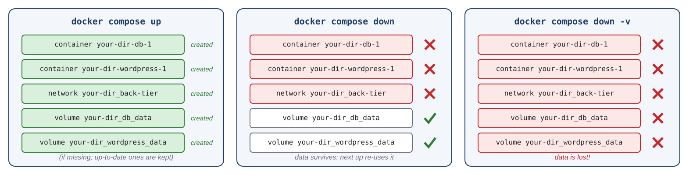

- Names are prefixed by the _project name_, i.e. the name of the directory containing `compose.yaml` (e.g. `your-dir`)
    + can be overridden via `-p <project name>` or the top-level `name` attribute

---

## Working example (pt. 1)


{}

```yaml
services:
  db:
    image: mariadb:latest
    volumes:
      - db_data:/var/lib/mysql
    restart: always
    networks:
      - back-tier
    environment:
      MYSQL_ROOT_PASSWORD: "..Password1.."
      MYSQL_DATABASE: wordpress_db
      MYSQL_USER: wordpress_user
      MYSQL_PASSWORD: ",,Password2,,"
    healthcheck:
      test: [ "CMD", "healthcheck.sh", "--su-mysql", "--connect", "--innodb_initialized" ]
      start_period: 1m
      start_interval: 10s
      interval: 1m
      timeout: 5s
      retries: 3
    
  wordpress:
    depends_on:
      db:
        condition: service_healthy # wait for the healthcheck to pass
    image: wordpress:latest
    volumes:
      - wordpress_data:/var/www/html
    ports:
      - "8000:80"
    restart: always
    networks:
      - back-tier
    environment:
      WORDPRESS_DB_HOST: db:3306
      WORDPRESS_DB_USER: wordpress_user
      WORDPRESS_DB_PASSWORD: ",,Password2,,"
      WORDPRESS_DB_NAME: wordpress_db
volumes:
  db_data: {}
  wordpress_data: {}
networks:
  back-tier: {}
```
{}
{}
> __Beware__: this is unsafe as passwords are in clear text!

<br/>

### TODO

1. Copy-paste this code in a file named `your-dir/compose.yaml`

2. `cd your-dir`

3. `docker compose up` and then inspect the logs

4. open your browser and browse to <http://localhost:8000>

5. `docker ps` and have a look at the running containers
    + and `docker network ls` 
    + and `docker volume ls`

6. Press `Ctrl+C` to stop the stack

7. `docker compose down --volumes` to delete the stack


{}


---

## Working example (pt. 2)

- Example of `docker compose up` logs:
    ```
    docker compose up
    [+] Building 0.0s (0/0) docker:default
    [+] Running 5/5
    ✔ Network your-dir_back-tier        Created  0.1s 
    ✔ Volume "your-dir_wordpress_data"  Created  0.1s 
    ✔ Volume "your-dir_db_data"         Created  0.0s 
    ✔ Container your-dir-db-1           Created  0.8s 
    ✔ Container your-dir-wordpress-1    Created  0.9s 
    Attaching to db-1, wordpress-1
    db-1         | 2023-11-23 14:24:57+00:00 [Note] [Entrypoint]: Entrypoint script for MariaDB Server 1:11.2.2+maria~ubu2204 started.
    db-1         | 2023-11-23 14:24:57+00:00 [Note] [Entrypoint]: Switching to dedicated user 'mysql'
    db-1         | 2023-11-23 14:24:57+00:00 [Note] [Entrypoint]: Entrypoint script for MariaDB Server 1:11.2.2+maria~ubu2204 started.
    db-1         | 2023-11-23 14:24:57+00:00 [Note] [Entrypoint]: Initializing database files
    wordpress-1  | WordPress not found in /var/www/html - copying now...
    wordpress-1  | Complete! WordPress has been successfully copied to /var/www/html
    wordpress-1  | No 'wp-config.php' found in /var/www/html, but 'WORDPRESS_...' variables supplied; copying 'wp-config-docker.php' (WORDPRESS_DB_HOST WORDPRESS_DB_NAME WORDPRESS_DB_PASSWORD WORDPRESS_DB_USER)
    wordpress-1  | AH00558: apache2: Could not reliably determine the server's fully qualified domain name, using 172.22.0.3. Set the 'ServerName' directive globally to suppress this message
    wordpress-1  | AH00558: apache2: Could not reliably determine the server's fully qualified domain name, using 172.22.0.3. Set the 'ServerName' directive globally to suppress this message
    wordpress-1  | [Thu Nov 23 14:24:58.289485 2023] [mpm_prefork:notice] [pid 1] AH00163: Apache/2.4.56 (Debian) PHP/8.0.30 configured -- resuming normal operations
    wordpress-1  | [Thu Nov 23 14:24:58.289516 2023] [core:notice] [pid 1] AH00094: Command line: 'apache2 -D FOREGROUND'
    ...
    ```

    + notice that the outputs of the two containers are interleaved

- Example of `docker ps` logs:
    ```
    CONTAINER ID   IMAGE              COMMAND                  CREATED         STATUS                   PORTS                                   NAMES
    4691a9641135   wordpress:latest   "docker-entrypoint.s…"   9 minutes ago   Up 9 minutes             0.0.0.0:8000->80/tcp, :::8000->80/tcp   your-dir-wordpress-1
    314feb9d42ab   mariadb:latest     "docker-entrypoint.s…"   9 minutes ago   Up 9 minutes (healthy)   3306/tcp                                your-dir-db-1
    ```

- Example of `docker network ls` logs:
    ```
    NETWORK ID     NAME                 DRIVER    SCOPE
    b304d1ae5404   bridge               bridge    local
    1bb39315ff98   host                 host      local
    03c8700dee6a   none                 null      local
    470d81d26296   your-dir_back-tier   bridge    local
    ```

---

## Working example (pt. 3)


{}

### Let's make the stack more secure

1. Let's create a file containing the DB root password, say `db_root_password.txt`:
    * `echo -n "..Password1.." > your-dir/db_root_password.txt`

2. Let's create a file containing the DB user password, say `db_password.txt`:
    * `echo -n ",,Password2,," > your-dir/db_password.txt`

3. Let's edit the stack as described on the right
    * __remove__ the clear-text `MYSQL_ROOT_PASSWORD`, `MYSQL_PASSWORD`, and `WORDPRESS_DB_PASSWORD` variables
    * replace them with their `_FILE` counterparts, pointing to the secrets

{}
{}

```yaml
services:
  db:
    ...
    environment:
      ...
      MYSQL_ROOT_PASSWORD_FILE: /run/secrets/db_root_password
      MYSQL_PASSWORD_FILE: /run/secrets/db_password
    ...    
    secrets:
      - db_root_password
      - db_password
    
  wordpress:
    ...
    environment:
      ...
      WORDPRESS_DB_PASSWORD_FILE: /run/secrets/db_password
    ...
    secrets:
      - db_password

volumes:
  db_data: {}
  wordpress_data: {}

networks:
  back-tier: {}

secrets:
  db_password:
    file: db_password.txt
  db_root_password:
    file: db_root_password.txt
```

{}


---

## Docker Compose for testing

- Docker Compose is also useful for software __testing__

- E.g. whenever the system under test relies on some _infrastructural component_
    * e.g. a database, a message broker, a cache, etc.

- Usual workflow for testing:
    1. __start__ the component
    2. __run__ the system under test
    3. __stop__ the component

- Docker Compose may be coupled with some __test framework__ of choice to __automate__ the process

---

## Docker Compose for testing: the workflow

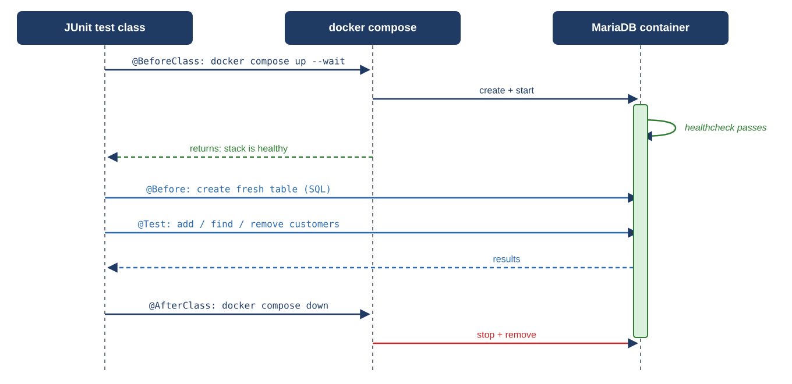

---

## Example: Docker Compose for testing + JUnit (pt. 1)

### Domain model


interface Customer {
    + id: CustomerID
    + firstName: String 
    + lastName: String
    + birthDate: LocalDate
    ...
    + name: String
    + isPerson: Boolean
    + isCompany: Boolean
}
note bottom: Entity

interface CustomerID {
    + value: Any
}
note right: Value Object

interface TaxCode {
    + value: String
}
note left: Value Object

interface VatNumber {
    + value: Long
}
note right: Value Object

VatNumber -d-|> CustomerID
TaxCode -d-|> CustomerID

Customer *-r- CustomerID

interface CustomerRepository {
    + findById(id: CustomerID): Iterable<Customer>
    + findByName(name: String): Iterable<Customer>
    + add(customer: Customer)
    + update(oldId: CustomerID, customer: Customer)
    + remove(id: CustomerID)
}
note left: Repository

CustomerRepository o-r- Customer



---

## Example: Docker Compose for testing + JUnit (pt. 2)

### Implementation details



interface CustomerRepository {
    + findById(id: CustomerID): Iterable<Customer>
    + findByName(name: String): Iterable<Customer>
    + add(customer: Customer)
    + update(oldId: CustomerID, customer: Customer)
    + remove(id: CustomerID)
}

class SqlCustomerRepository {
    - connections: ConnectionFactory
    - tableName: String
    + createTable(replaceIfPresent: Boolean = false)
}

SqlCustomerRepository --|> CustomerRepository

package "db" {
    interface ConnectionFactory {
        + connect(): Connection
    }
    interface MariaDB {
        + database: String
        + username: String
        + password: String
        + host: String
        + port: Int
    }
    class MariaDBConnection
    MariaDBConnection --|> MariaDB
    MariaDBConnectionFactory --|> ConnectionFactory
    MariaDBConnectionFactory ..> MariaDBConnection: creates
}

SqlCustomerRepository .r.> MariaDBConnectionFactory: uses

package "java sql" {
    interface Connection
    ConnectionFactory ..> Connection: creates
    MariaDBConnection --|> Connection
}



---

## Example: Docker Compose for testing + JUnit (pt. 3)


{}
```kotlin
class TestMariaDBCustomerRepository {

    companion object {
        @BeforeClass @JvmStatic fun setUpMariaDb() { TODO("compose up") }
        @AfterClass @JvmStatic fun tearDownMariaDb() { TODO("compose down") }
    }

    private val connectionFactory = MariaDBConnectionFactory(DATABASE, USER, PASSWORD, HOST, PORT)
    private lateinit var repository: SqlCustomerRepository

    @Before
    fun createFreshTable() {
        repository = SqlCustomerRepository(connectionFactory, TABLE)
        repository.createTable(replaceIfPresent = true)
    }

    private val taxCode = TaxCode("CTTGNN92D07D468M")
    private val person = Customer.person(taxCode, "Giovanni", "Ciatto", LocalDate.of(1992, 4, 7))
    private val person2 = person.clone(
        birthDate = LocalDate.of(1992, 4, 8),
        id = TaxCode("CTTGNN92D08D468M"),
    )
    private val vatNumber = VatNumber(12345678987L)
    private val company = Customer.company(vatNumber, "ACME", "Inc.", LocalDate.of(1920, 1, 1))

    @Test
    fun complexTestWhichShouldActuallyBeDecomposedInSmallerTests() {
        assertEquals(
            expected = emptyList(),
            actual = repository.findById(taxCode),
        )
        assertEquals(
            expected = emptyList(),
            actual = repository.findById(vatNumber),
        )
        repository.add(person)
        repository.add(company)
        assertEquals(
            expected = listOf(person),
            actual = repository.findById(taxCode),
        )
        assertEquals(
            expected = listOf(company),
            actual = repository.findById(vatNumber),
        )
        repository.remove(vatNumber)
        repository.update(taxCode, person2)
    }
}
```

{}
{}
- Unit test for the `SqlCustomerRepository` class

- Requires an instance of MariaDB to be tested

- Let's use Docker Compose to start / stop MariaDB

- Try to complete the implementation of the `setUpMariaDb` and `tearDownMariaDb` methods
    + use Java's `ProcessBuilder`s to call `docker compose` commands

- Template for Docker Compose files available among test resources
    + [`docker-compose.yml.template`](https://github.com/unibo-spe/docker-compose-testing/blob/exercise/src/test/resources/it/unibo/spe/compose/docker-compose.yml.template)
        * does it require edits? why?

- Code for the exercise:
    * https://github.com/unibo-spe/docker-compose-testing

- In practice, libraries like [Testcontainers](https://testcontainers.com/) automate this very pattern
{}


---



# Running experiments in parallel

## With Docker Compose

---

## Experiments as jobs

> Recall: [jobs](#/motivation) eventually terminate, and may exploit __parallelism__ to speed up the computation

- Experiments (simulations, data analyses, ML trainings, benchmarks...) are typical __jobs__
    + _input_: data + __parameters__ $\rightarrow$ _output_: results (metrics, models, plots, logs)
    + often run as __parameter sweeps__ (e.g. grid search, multiple seeds): many _independent_ runs
    + independent runs are trivially __parallelisable__

- Why containerise them?
    + __reproducibility__: same image $\Rightarrow$ same OS, runtime, and _pinned_ dependencies, everywhere
    + __automation__: one command (re-)runs all experiments, possibly in CI
    + __scalability__: the same image runs in parallel on one machine (Compose) or on a cluster (Swarm)

> __Running example__: <https://github.com/unibo-spe/containerized-experiment>, whose _commit history_ we follow step by step, \
> from a Jupyter notebook to parallel, containerised experiments

---

## The running example, in plain words

No background in machine learning (ML) is needed: what matters is the _shape_ of the computation

- __Dataset__: a table of _examples_, here [Iris](https://www.openml.org/d/61): 150 flowers, 4 measurements each, plus their _species_ (the _label_)
- __Model__: an algorithm that _learns_ from examples to predict the label of new ones
    + e.g. a decision tree, a neural network (MLP), a logistic regression, a support vector machine (SVM)
- __Hyper-parameters__: the _knobs_ of a model (e.g. the maximum depth of a tree), to be chosen _before_ training
- __Grid search__: train a model for _every combination_ of knob values, keep the best one
    + quality is measured as __accuracy__ (% of correct predictions) on examples _not_ used for training

<br/>

> For us, an experiment is: _input data_ + _parameters_ $\rightarrow$ _many independent trainings_ $\rightarrow$ _results_ (scores, plots, the best model)

---

## Where experiments are born: Jupyter notebooks

{}
{}
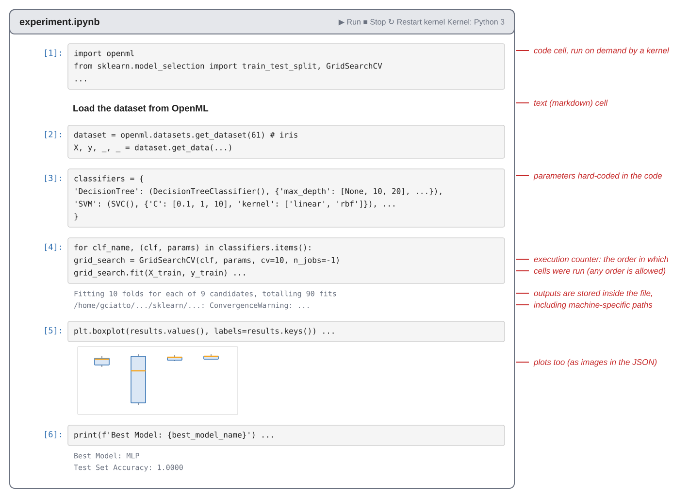
{}
{}
- A [Jupyter](https://jupyter.org/) __notebook__ is a document mixing _code_, _text_, and _outputs_
    + stored as a JSON file (`.ipynb`)
    + edited in the browser (e.g. via `jupyter lab`)
- Code __cells__ are executed _on demand_, one at a time, by a __kernel__
    + i.e. a Python process which keeps _all variables_ in memory between cells
- Great for _exploration_: try something, look at the output, adjust, repeat
- Very common in data science and research
    + our running example _starts_ as a notebook ([`078562f`](https://github.com/unibo-spe/containerized-experiment/tree/078562ffb8887104e4c53355933f5a6c6bfbee54))
{}
{}

---

## The bad situation: experiments in notebooks

What is great for exploration is bad for __reproducibility__ and __automation__:

- __Hidden state__: cells can be run in _any order_, and re-run, so the results depend on the click history
    + "Restart kernel and run all" may give _different_ results, or fail
- __Hard-coded parameters__: trying another configuration means _editing_ the code, then re-running by hand
- __Implicit environment__: which Python? which library versions? whatever was installed on the author's machine
- __Outputs mixed with code__: results live _inside_ the `.ipynb` (with paths like `/home/gciatto/...`), or in the current directory
- __No automation__: a notebook needs a human (and a browser) to be run, so no CI, no remote / batch execution
- __Poor version control__: diffs of a JSON with embedded images are hardly readable
- __Sequential__: all configurations run one after the other, in the same process

> Goal: turn the notebook into an experiment which anybody can (re-)run, _in parallel_, with __one command__

---

## The plan: one commit per step

Inspect each step via `git checkout <commit>` in the [repository](https://github.com/unibo-spe/containerized-experiment):

| Step | Commit | What changes |
|------|--------|--------------|
| 0 | [`078562f`](https://github.com/unibo-spe/containerized-experiment/tree/078562ffb8887104e4c53355933f5a6c6bfbee54) | the experiment is a _notebook_ (the bad situation) |
| 1 | [`84d3822`](https://github.com/unibo-spe/containerized-experiment/tree/84d3822c777b8105e8dce1fa8736429399952a38) | notebook $\rightarrow$ _script_, parameters from _environment variables_ |
| 2 | [`9345702`](https://github.com/unibo-spe/containerized-experiment/tree/93457028ebe4fb9db5b4592fdcb06bd25ecc0d03) | _dockerise_: `Dockerfile` + Compose file |
| 3 | [`9e78fce`](https://github.com/unibo-spe/containerized-experiment/tree/9e78fce8e24ddcb7fcf4dea8ed72be6c96eb100a), [`b6823d3`](https://github.com/unibo-spe/containerized-experiment/commit/b6823d3) | fix the _ownership_ of results on the host |
| 4 | [`0fc62ff`](https://github.com/unibo-spe/containerized-experiment/tree/0fc62ffa7354fd3f8b56c265c65112dacd1268bd) | _skip_ experiments which were already executed |
| 5 | [`8293534`](https://github.com/unibo-spe/containerized-experiment/tree/829353426f4044b1f72a5dc03027580580ad6246) | move the _grids_ of hyper-parameters out of the code |
| 6 | [`19ba9fe`](https://github.com/unibo-spe/containerized-experiment/tree/19ba9fe0f0d0f990a25bd2e7e9ff5b7326140a7e) | one Compose _service per configuration_ $\Rightarrow$ __parallelism__ |
| 7 | [`f63c762`](https://github.com/unibo-spe/containerized-experiment/tree/f63c7623017dfe09046459b467419a503d1d55ed) | polishing: resource limits, updated dependencies, robust scripts |

---

## Step 1: from notebook to script

{}
{}


full script [here](https://github.com/unibo-spe/containerized-experiment/blob/84d3822c777b8105e8dce1fa8736429399952a38/experiment.py)
{}
{}
- `jupyter nbconvert --to script experiment.ipynb` gives a _starting point_: the code of all cells, in order
- Then, clean it up:
    + drop interactive bits (e.g. `plt.show()`)
    + __parameters__ come from _environment variables_, with safe _defaults_
    + __outputs__ (plot, best model) go into a configurable directory (`OUTPUT_DIR`)
- The script runs top to bottom, with no human in the loop: `python experiment.py`
- The notebook is _deleted_: one source of truth
{}
{}

---

## Step 2: dockerise

{}
{}
`Dockerfile`


`docker-compose.yml`

{}
{}
- The __environment__ becomes _explicit_: Python version (`ARG`), _pinned_ dependencies (`requirements.txt`)
- Dependencies are installed _before_ copying the code (cf. [caching](#/caching))
- Results go to `/data`, _bind-mounted_ onto `./data` on the host
- Parameters can be overridden in the Compose file (`environment`)
- Running the experiment, on any machine with Docker: `docker compose up`
{}
{}

---

## Step 3: who owns the results?

> Recall: files written by containers via bind mounts are [owned by `root`](#/bind-mounts-ownership) on the host

{}
{}
First attempt ([`9e78fce`](https://github.com/unibo-spe/containerized-experiment/tree/9e78fce8e24ddcb7fcf4dea8ed72be6c96eb100a)): `chown` at the end of the run


Final solution ([`b6823d3`](https://github.com/unibo-spe/containerized-experiment/commit/b6823d3)): run as the host user

{}
{}
- `chown` at the _end_ is fragile: if the experiment fails, files stay owned by `root`
- Better: let containers run as the _host user_ (`user`, or `docker run --user`)
    + `export HOST_UID=$(id -u) HOST_GID=$(id -g)` before `docker compose up`
    + not `UID`: in Bash it is _read-only_ and not exported, while `GID` does not exist
- Consequences:
    + that user has _no home_ in the image $\Rightarrow$ `ENV HOME=/tmp`, for libraries' caches
    + `./data` must _exist_ before starting, otherwise Docker creates it as `root` (hence `data/.gitkeep`)
{}
{}

---

## Step 4: do not run the same experiment twice


- Parameter sweeps take long, and get _interrupted_: re-running `docker compose up` should only run the _missing_ experiments
- Results are saved __before__ the ID file: a run is considered _done_ only if it completed

---

## Step 4: do not run the same experiment twice (code)



- The __footprint__ is the set of _all_ parameters affecting the results
    + forgetting one (e.g. the dataset) means two different experiments get the _same_ ID
- `yaml.dump(..., sort_keys=True)` makes the footprint _canonical_: same parameters $\Rightarrow$ same ID

---

## Step 5: parameters out of the code

{}
{}

{}
{}
- In the notebook, the grids of hyper-parameters were _hard-coded_ in a Python dictionary
- Now each model is an environment variable `MODEL_<name>`, whose value is a _YAML document_:
    + the model's _class name_, and the _values_ to try for each hyper-parameter
- The script reads all `MODEL_*` variables (via `yaml.safe_load`), and creates the models _by name_ (via `importlib`)
- Changing the experiments means changing the _Compose file_, not the code
- Still, a _single_ container trains all models, _one after the other_
{}
{}

---

## Step 6: one service per configuration (pt. 1)

{}
{}

{}
{}
- __One service per configuration__ (here, per model and grid of hyper-parameters)
    + they only differ in their `environment` (and `hostname`)
- YAML __anchors__ (`&name`) and __aliases__ (`*name`) avoid repeating the shared parts
    + `build`, `volumes`, `user`, `deploy`
- The grid of each model is a YAML document _inside_ an environment variable (`MODEL_*`)
    + parsed by `experiment.py` via `yaml.safe_load`

shown in its _final_ version (after step 7), full file [here](https://github.com/unibo-spe/containerized-experiment/blob/master/compose.yaml)
{}
{}

---

## Step 6: one service per configuration (pt. 2)


- `docker compose up`: builds the image (once), then runs __all__ experiments __in parallel__
- `docker compose up experiment-svm`: runs just _one_ of them
- `docker compose logs -f experiment-mlp`: follows the output of one experiment

---

## Step 7: polishing

{}
{}
`Dockerfile`


`run.sh`

{}
{}
- Only the dependencies actually needed by the script (no Jupyter), updated, on Python 3.14
- The run logic moved to `run.sh`:
    + each run writes into a _fresh_ directory, named after date and `hostname`
    + `set -o pipefail`: failures of `python` are not masked by `tee`
    + skipped experiments leave no empty directories behind
- `CMD` in _exec_ form, `HOME=/tmp` for the host user (cf. step 3)
{}
{}

---

## Step 7: not overloading the machine

{}
{}

{}
{}
- Parallel containers compete for the _same_ CPUs and memory
    + without limits, one hungry experiment may slow down (or _kill_, by memory exhaustion) the others
- `deploy.resources.limits` caps each container
    + `cpus: "1"`: at most one CPU's worth of time
    + `memory: 2G`: the container is killed if it exceeds it
- Keep limits _consistent_ with the experiment's own parallelism
    + e.g. `GridSearchCV(n_jobs=...)` should not exceed `cpus`
- `docker stats` shows the actual usage of running containers
{}
{}

---

## Scaling out: experiments on a Swarm

{}
{}
```yaml
services:
  experiment-svm:
    image: <username>/containerized-experiment:1.0.0
    hostname: svm
    environment:
      MODEL_SVM: |
        sklearn.svm.SVC:
          C: [0.1, 1, 10]
          kernel: ['linear', 'rbf']
    volumes:
      - results:/data
    deploy:
      mode: replicated-job   # run to completion
      replicas: 1
      restart_policy:
        condition: none
      resources:
        limits: { cpus: "1", memory: 2G }
  # ... other experiments ...
volumes:
  results:
    driver: local
    driver_opts:
      type: "nfs"
      o: "addr=NFS_SERVER_ADDRESS,rw"
      device: ":/path/to/results/"
```
{}
{}
- The same stack can be deployed on a [Swarm](#/swarm), to run experiments on _several_ nodes
- Differences w.r.t. Compose:
    + Swarm does not `build`: the image must be [pushed](#/publishing) to a registry first
    + `mode: replicated-job`: tasks run until they _complete_ (exit code 0), rather than forever
    + `restart_policy: none`: failed experiments are not restarted in a loop
    + results must land on [storage shared among nodes](#/sharing-among-nodes), e.g. NFS
- `docker service ls` reports progress, e.g. `0/1 (1/1 completed)`
{}
{}

---

## Exercise: containerise your own experiment

Repository: <https://github.com/unibo-spe/containerized-experiment>

1. Select some experiment of your choice
    + e.g. from a course you attended, from your thesis, or from a published paper
    + better if it is a Jupyter notebook

2. Containerise it, in such a way that:
    + only scripts are present (no notebooks)
    + the experiments can be run via Docker Compose
    + the results are saved in a folder on the host machine, _owned by the host user_
    + the parameters of the experiments are set via environment variables
    + experiments already executed for a given assignment of parameters are _skipped_
    + different assignments of parameters run _in parallel_, each with _capped resources_

3. Bonus: build the image and run the experiments in CI (cf. [Continuous Integration](../07-ci/))

---



# Orchestration

## With Docker Swarm

---

## Swarm architecture

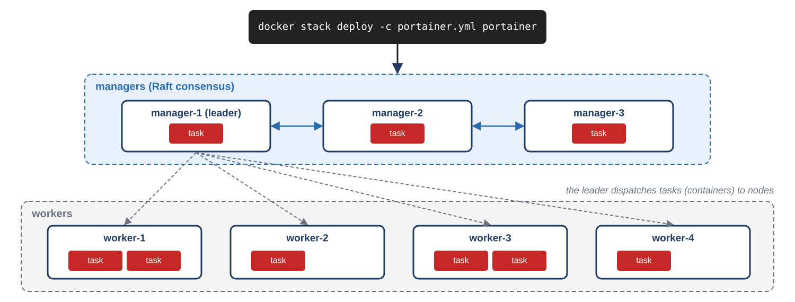

- Docker Compose deploys a stack on a _single_ host, Docker Swarm deploys it on a __cluster__ of hosts (_nodes_)
- Users submit stacks to __managers__ (e.g. via `docker stack deploy`), which keep the cluster state _consistent_ via Raft
- Managers turn services into __tasks__ (i.e. containers), and dispatch them onto nodes, workers or managers alike

---

## Building the cluster (theory)

- In a Docker Swarm cluster, there are two kinds of nodes:
    + __manager__ nodes, which coordinate the cluster by means of the [Raft consensus protocol](https://docs.docker.com/engine/swarm/raft/)
        * they may also act as worker nodes
    + __worker__ nodes, which simply run containers

<br/>

- To set up a cluster, one must:
    1. __initialise__ Swarm mode on _one node of choice_
        + that will become the first __manager__ node
    2. optionally, let other nodes __join__ the cluster as worker nodes
    3. optionally, __elevate__ some worker nodes to manager nodes
        + this operation can _only_ be done by a client connected to some _manager_ node
        + it is better to have __multiple__ manager nodes for redundancy
        + it is better to have an __odd__ number of manager nodes
            * e.g. 3, 5, 7, etc.

---

## Building the cluster (practice)

1. On one node running the Docker daemon (say, the teacher's machine), initialise Swarm mode as follows:
    * `docker swarm init`
    * this will output a command to be run on other nodes to join the cluster:
        ```
        Swarm initialized: current node (<NODE_ID>) is now a manager.

        To add a worker to this swarm, run the following command:

            docker swarm join --token <SECRET_TOKEN> <NODE_ADDRESS>:2377

        To add a manager to this swarm, run 'docker swarm join-token manager' and follow the instructions.
        ```

2. On other nodes running the Docker daemon (say students' machines), initialise Swarm mode as follows:
    * `docker swarm join --token <SECRET_TOKEN> <NODE_ADDRESS>:2377`
        + where `SECRET_TOKEN` and `NODE_ADDRESS` are the ones provided by the `docker swarm init` command above

3. On the manager node, one may inspect the node composition of the cluster via `docker node ls` (sample output)
    ```
    ID                            HOSTNAME            STATUS              AVAILABILITY        MANAGER STATUS      ENGINE VERSION
    4q3q3q3q3q3q3q3q3q3q3q3q3q *  node-1              Ready               Active              Leader              24.0.7
    5q4q4q4q4q4q4q4q4q4q4q4q4q    node-2              Ready               Active                                  24.0.7
    6q5q5q5q5q5q5q5q5q5q5q5q5q    node-3              Ready               Active                                  24.0.7
    ```

4. The manager node may __promote__ other nodes to manager nodes via `docker node promote <NODE_ID>`...
    * and it may __demote__ manager nodes to worker nodes via `docker node demote <NODE_ID>`
    * it also may __remove__ nodes from the cluster via `docker node rm <NODE_ID>`

5. Whenever done with this lecture, one may leave the Swarm via `docker swarm leave --force`
    + _remember to do this after the lecture_, otherwise you won't be able to use Swarm at home!

---

## Building the cluster (troubleshooting)

### Things that may go wrong

1. There may be a firewall blocking the communication among nodes
    * e.g. Windows Defender, the lab's firewall, your home router's firewall, etc.
    * you may notice the presence of a firewall by the fact that `docker swarm join` hangs or fails with a timeout
        - in the absence of a firewall, the command should succeed or fail almost immediately
    * troubleshooting:
        1. identify which and how many firewalls are in place
        2. ensure that the firewall allows communication for [Docker Swarm ports](https://docs.docker.com/engine/swarm/swarm-tutorial/#open-protocols-and-ports-between-the-hosts)
            + commonly: `2377/tcp`, `7946/tcp`, `7946/udp`, `4789/udp`

2. You use Docker on _Windows or Mac_, hence the Docker daemon runs on a _virtual machine_
    * in this case the IP of the virtual machine is different from the IP of your machine
    * the `NODE_ADDRESS` in `docker swarm join --token <SECRET_TOKEN> <NODE_ADDRESS>:2377` returned by `docker swarm init` is the IP of the virtual machine
    * troubleshooting:
        1. find the actual IP of your machine (e.g. `ipconfig` on Windows, `ifconfig` on Mac), let's call it `ACTUAL_IP`
        2. configure your host to redirect Swarm traffic received by `ACTUAL_IP` towards `NODE_ADDRESS`
            + for all ports listed above (`2377`, `7946`, `4789`)
        3. let other nodes use `ACTUAL_IP` instead of `NODE_ADDRESS` in `docker swarm join` when joining the cluster

---

## Swarm on Docker Desktop

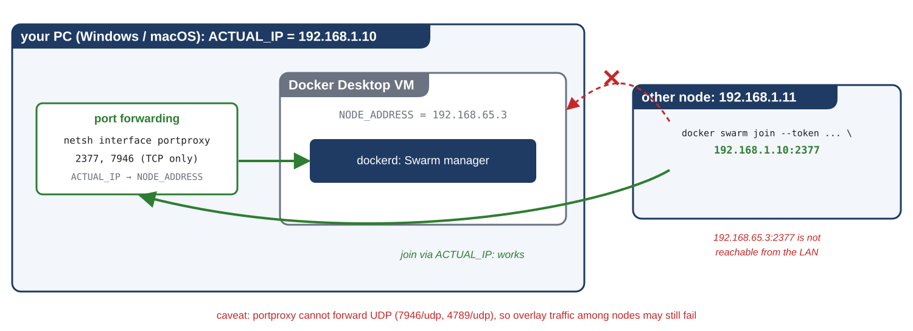

- The address printed by `docker swarm init` (`NODE_ADDRESS`) belongs to the Docker Desktop _VM_, which is not reachable from the LAN
- Other nodes must join via the PC's address (`ACTUAL_IP`), and the PC must forward Swarm traffic to the VM (cf. next slide)
- Forwarding via `netsh` is partial (TCP only): prefer Linux machines as Swarm nodes, or Docker Engine in WSL2 (cf. "Troubleshooting example on Windows (pt. 2)")

---

## Troubleshooting example on Windows (pt. 1)

### Opening ports on Windows Defender

On an administrator Powershell, run the following commands:
```powershell
netsh advfirewall firewall add rule name="Docker Swarm Intra-manager" dir=in action=allow protocol=TCP localport=2377
netsh advfirewall firewall add rule name="Docker Swarm Overlay Network Discovery TCP" dir=in action=allow protocol=TCP localport=7946
netsh advfirewall firewall add rule name="Docker Swarm Overlay Network Discovery UDP" dir=in action=allow protocol=UDP localport=7946
netsh advfirewall firewall add rule name="Docker Swarm Overlay Network Traffic" dir=in action=allow protocol=UDP localport=4789
```

- this operation should be done on all nodes of the cluster running on Windows

### Forwarding ports on Windows

On an administrator Powershell, run the following commands:
```powershell
netsh interface portproxy add v4tov4 listenport=2377 listenaddress=$ACTUAL_IP connectport=2377 connectaddress=$NODE_ADDRESS
netsh interface portproxy add v4tov4 listenport=7946 listenaddress=$ACTUAL_IP connectport=7946 connectaddress=$NODE_ADDRESS
```

- `portproxy` only forwards __TCP__: UDP traffic (`7946/udp` gossip, `4789/udp` overlay data) cannot be forwarded this way (cf. next slide)

- this operation should be done on the very first manager node of the cluster, if it's running on Windows

---

## Troubleshooting example on Windows (pt. 2)

### Forwarding UDP traffic too: Docker Engine in WSL2, mirrored networking

`netsh` cannot forward UDP: rather than forwarding, let the engine use the PC's own network interfaces

1. Enable [mirrored networking](https://learn.microsoft.com/en-us/windows/wsl/networking#mirrored-mode-networking) for WSL2 (Windows 11 22H2 or later), in `%UserProfile%\.wslconfig`:
    ```ini
    [wsl2]
    networkingMode=mirrored
    ```
    then restart WSL via `wsl --shutdown`

2. Allow inbound traffic towards WSL2 through the Hyper-V firewall (administrator PowerShell):
    ```powershell
    Set-NetFirewallHyperVVMSetting -Name '{40E0AC32-46A5-438A-A0B2-2B479E8F2E90}' -DefaultInboundAction Allow
    ```

3. Install [Docker Engine](https://docs.docker.com/engine/install/ubuntu/) _inside_ a WSL2 distribution (e.g. Ubuntu), and use it instead of Docker Desktop
    + Docker Desktop runs its engine in its own VM, which does not see the mirrored interfaces

4. From that distribution, use the PC's address when creating / joining the Swarm, for both TCP and UDP ports:
    + `docker swarm init --advertise-addr $ACTUAL_IP`, or
    + `docker swarm join --advertise-addr $ACTUAL_IP --token <SECRET_TOKEN> <MANAGER_ADDRESS>:2377`

> On macOS, the analogous solution is a Linux VM with a _bridged_ network adapter, running Docker Engine

---

## Stacks on Swarms

- One may deploy a stack on a Swarm cluster via `docker stack deploy -c <COMPOSE_FILE_PATH> <STACK_NAME>`
    + where `COMPOSE_FILE_PATH` is the path to a `.yml` file following the Docker Compose syntax
    + and `STACK_NAME` is the name of the stack to be deployed

- The command must be run on a client connected to some __manager__ node
    + try to run it on a _worker_ node and see what happens
    + try to run it on a _manager_ node when _half or more of the manager nodes are down_ (i.e. no quorum) and see what happens

- Other operations one may do on stacks (via a manager node):
    + `docker stack ls` to list stacks
    + `docker stack ps <STACK_NAME>` to list containers in a stack
    + `docker stack services <STACK_NAME>` to list services in a stack
    + `docker stack rm <STACK_NAME>` to remove a stack

- Semantics of stack _deployment_ on Swarms is __different from Docker Compose__:
    + different services may be __allocated__ on different nodes
    + services may be __replicated__ on different nodes
    + networks must rely on the `overlay` driver, to support inter-node communication among containers
    + some Compose attributes are __ignored__ (e.g. `depends_on`, `restart`, `build`), others only work in Swarm (e.g. `deploy`)

---



## Stack Deploy Example: [Portainer](https://www.portainer.io/)


{}
```yaml
services:
  agent:
    image: portainer/agent:lts
    volumes:
      - /var/run/docker.sock:/var/run/docker.sock
      - /var/lib/docker/volumes:/var/lib/docker/volumes
    networks:
      - agents_network
    deploy:
      mode: global # i.e., one (and only one) replica per node

  webservice:
    image: portainer/portainer-ce:lts
    command: -H tcp://tasks.agent:9001 --tlsskipverify
    ports:
      - "443:9443"
      - "9000:9000"
      - "8000:8000"
    volumes:
      - portainer_data:/data
    networks:
      - agents_network
    deploy:
      mode: replicated
      replicas: 1
      placement:
        constraints: 
          - node.role == manager

networks:
  agents_network:
    driver: overlay
    attachable: true

volumes:
  portainer_data:
```
{}
{}
- Portainer is a Web-based dashboard for cluster administration
    * it works with both Docker Swarm and Kubernetes

- It is composed of two services:
    * `webservice`, the actual dashboard
    * `agent`, a service running on each node, which exposes the Docker API to the `webservice` service

<br/>

1. Let's save the code on the left in a file named `portainer.yml`

2. Let's deploy the stack via `docker stack deploy -c portainer.yml portainer`

3. Let's then browse to <https://localhost> on some manager node
{}


---

## Portainer's Initial Configuration



let's use `software-process-engineering` as the password for the `admin` user

---

## Portainer's Home Page

Upon login, you are presented with the _home page_, which asks you to select one __environment__
+ __environments__ are clusters (one Portainer instance may manage multiple clusters)



---

## Portainer's Dashboard

Upon environment selection, one is presented with the _dashboard_, showing the __status of the cluster__



--- 

## Things to notice via Portainer

After selecting the only environment available, one may observe:
- which and how many __nodes__ compose the cluster (_Dashboard_ section)
    + you may use the _cluster visualiser_ to spot your machine in the cluster
        * (assuming that you managed to join the cluster)

- which __stacks__ are running on the cluster (_Services_ section)
    + you may observe that the `portainer` stack is running

- which __services__ are running on the cluster (_Services_ section)
    + you may observe that the `portainer` stack is composed of two services: `agent` and `webservice`

- which __containers__ are running on the cluster (_Containers_ section)
    + you may observe that the `portainer_agent` service is composed of _one container per node_
    + you may observe that the `portainer_webservice` service is composed of _one container_ which is _running on some manager node_

- which __volumes__ are present on the cluster (_Volumes_ section)
    + you may observe that the `portainer_portainer_data` volume is present _on the same manager node_ of `portainer_webservice`

- which __networks__ are present on the cluster (_Networks_ section)
    + you may observe that the `portainer_agents_network` network is present, using the `overlay` driver

---



## Labelling nodes

> Nodes may be __labelled__ with `key=value` pairs

- Labels may be used to __mark nodes__ with respect to their __properties__
    + e.g. hardware / software __capabilities__
        * e.g. `capabilities.cpu=yes`
        * e.g. `capabilities.web=yes`
        * e.g. `capabilities.storage=yes`

- This can be done _programmatically_....
    + e.g. via `docker node update --label-add KEY=VALUE NODE_ID`

- ... or via __Portainer__:

    

- labels can be used to set _placement_ __constraints__ or __preferences__ for services:
    * placement _constraints_: one service can only be deployed onto nodes with given labels
    * placement _preferences_: one service's _replicas_ will be _spread_ among nodes with given labels

---
 
## Example of placement constraints


{}
```yaml
services:
  db:
    image: mariadb:latest
    ...
    deploy:
      placement:
        constraints: 
          - node.labels.capabilities.storage==yes
  wordpress:
    image: wordpress:latest  # depends_on is ignored by Swarm
    ports:
      - "8889:80"
    ...
    deploy:
      placement:
        constraints: 
          - node.labels.capabilities.web==yes
volumes:
  db_data: {}
  wordpress_data: {}
networks:
  back-tier: {}
```
{}
{}
- Let's define a stack for Wordpress, with __placement constraints__
    + `db` service on a node with _storage_ capabilities
    + `wordpress` service on a node with _web_ capabilities

- E.g., on a cluster with nodes `storage1`, `inference1`, `inference2`, and `inference4`:
    - node `storage1` has _storage_ capabilities
    - node `inference2` has _web_ capabilities

- The deployment is as follows:

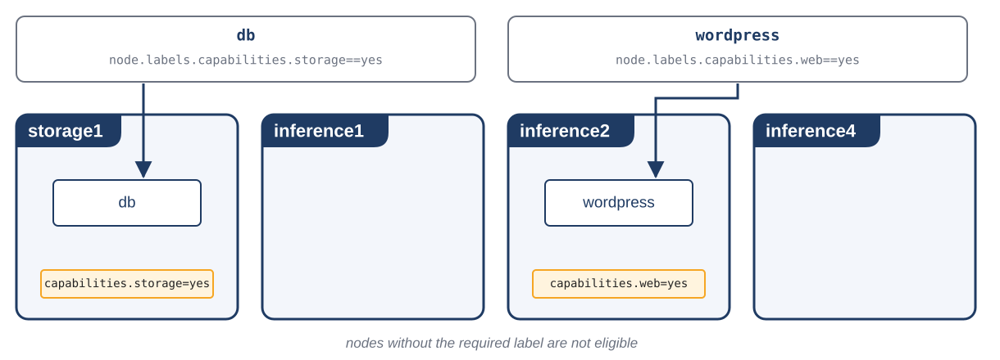
{}


---

## Exposing ports on the Swarm

When a service _exposes a port_, and that's deployed on a _Swarm_:

- the service is exposed on __all nodes__ in the Swarm (managers _and_ workers)
    + this is the so-called [__routing mesh__](https://docs.docker.com/engine/swarm/ingress/)
    + requests reaching _any_ node are forwarded to some node actually hosting a replica

- so, the `wordpress` service above could be visited via _any_ node of the cluster, e.g.:
    + `http://storage1:8889`
    + `http://inference1:8889`
    + `http://inference2:8889` (the node actually hosting the service)

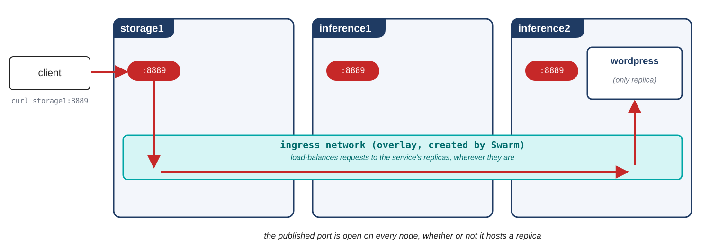

---

## Service replication (pt. 1)

- Services may be __replicated__ for the sake of scalability / load-balancing / fault-tolerance, etc.

- Two types of services:
    + `global`: replicated _exactly_ __once per node__
    + `replicated`: replicated `N` times (with `N=1` by _default_)

- General case:
    ```yaml
    services:
      service-name:
        ...
        deploy:
          mode: replicated
          replicas: N                  # this should be a number!
          placement:
            constraints: 
              - node.role == manager
              - node.labels.mylabel==myvalue
            preferences:
              - spread: node.labels.mylabel
            max_replicas_per_node: M      # this should be a number!
    ```

- How to read it:
    + `N` replicas of the service will be deployed
    + each one will be deployed on a __manager node__ having the `mylabel` label set to `myvalue`
    + replicas will be _spread_ among the admissible nodes, as evenly as possible
    + no more than `M` replicas will be put on the same node

---

## Service replication (pt. 2)

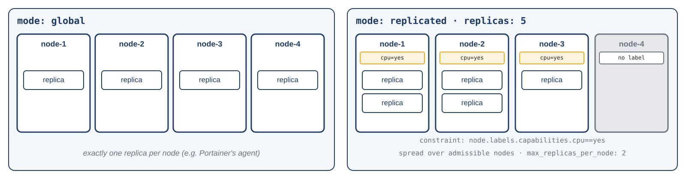

- `global` services follow the cluster: when a node joins, it gets a replica; when it leaves, its replica is gone
- `replicated` services keep _exactly_ `N` replicas alive, re-scheduling them when a node fails (if constraints allow)

---
 
## Example of placement preferences


{}
```yaml
services:
  ws:
    image: pikalab/hitcounter:latest
    ports:
      - "8890:8080"
    deploy:
      replicas: 10
      placement:
        constraints: 
          - node.labels.capabilities.cpu==yes
        preferences:
          - spread: node.labels.capabilities.cpu
```

<br/>

2. Try to query it multiple times:
    ```bash
    while true; do
        curl http://<ANY_NODE_ADDRESS>:8890; 
        echo 
        sleep 1
    done
    ```

    expected outcome:

    ```
    [9a6f89a39f8fd379@a3838ab6a606:8080] Hit 1 times
    [26c39b9f3d7f0cab@4ad25c3e148c:8080] Hit 1 times
    [97945332d20e71ed@969586109dee:8080] Hit 1 times
    [3b3256852103312a@5d3479044fac:8080] Hit 2 times
    [49e75aaae823c1e4@36e31b946486:8080] Hit 2 times
    [497583c21d17ad58@7c10a84858f3:8080] Hit 2 times
    [cf82689c910dfdf3@8aaa34535824:8080] Hit 2 times
    [9a456666c413f4a4@5ba876916f68:8080] Hit 2 times
    [41cadc9e0d7b0225@6cf54f65cda6:8080] Hit 2 times
    [84dbbff08ac91e74@4006352af1e0:8080] Hit 2 times
    [9a6f89a39f8fd379@a3838ab6a606:8080] Hit 2 times
    [26c39b9f3d7f0cab@4ad25c3e148c:8080] Hit 2 times
    [97945332d20e71ed@969586109dee:8080] Hit 2 times
    [3b3256852103312a@5d3479044fac:8080] Hit 3 times
    [49e75aaae823c1e4@36e31b946486:8080] Hit 3 times
    ...
    ```
{}
{}
1. Several replicas of the same service are created:
    
    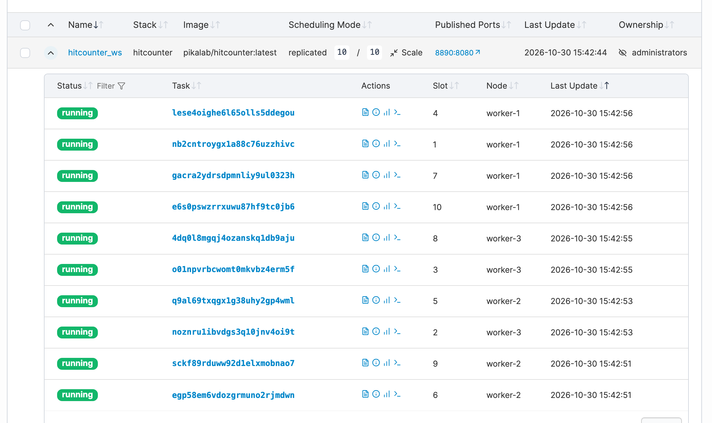

<br/>

3. Requests will be forwarded to replicas in a __non-deterministic__ fashion
{}


---

## Docker Swarm and Volumes


{}
> Volumes are __always local__ w.r.t. the node the current container is deployed onto

<br/>

```yaml
services:
  simulation:
    image: pikalab/fakesim:latest
    deploy:
      restart_policy:
        condition: on-failure # restart is ignored by Swarm
      replicas: 3
      placement:
        constraints: 
          - node.labels.capabilities.cpu==yes
        max_replicas_per_node: 1
    volumes:
      - type: volume
        source: shared_volume
        target: /data
volumes:
    shared_volume: {}
```
{}
{}
1. Several replicas of the simulation are created...
    
    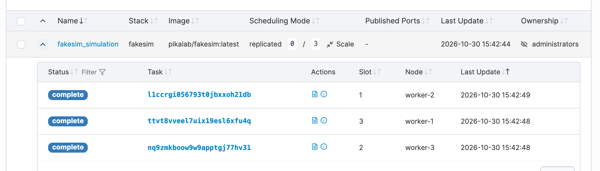


2. ... as well as several volumes!

    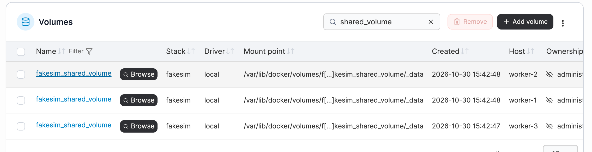

    - one per replica, on the same node as the replica

3. How to share data? (cf. next slide)

{}


---



## Sharing data among nodes

{}
{}
- Since volumes are _local_ to nodes, replicas on different nodes do __not__ see each other's data

- To share data, volumes must be backed by some __network file system__ reachable from all nodes
    + e.g. an [NFS](https://en.wikipedia.org/wiki/Network_File_System) server, as discussed for [volumes in Compose](#/compose)

    ```yaml
    services:
      simulation:
        ...
        volumes:
          - type: volume
            source: shared_volume
            target: /data
    volumes:
      shared_volume:
        driver: local
        driver_opts:
          type: "nfs"
          o: "addr=NFS_SERVER_ADDRESS,nolock,soft,rw"
          device: ":/path/on/the/nfs/server/"
    ```

- Each node still creates its own _local_ volume, but all of them point to the same remote folder
    + alternatives: _volume plugins_ for distributed storage, or object stores (e.g. S3) accessed by the application
{}
{}
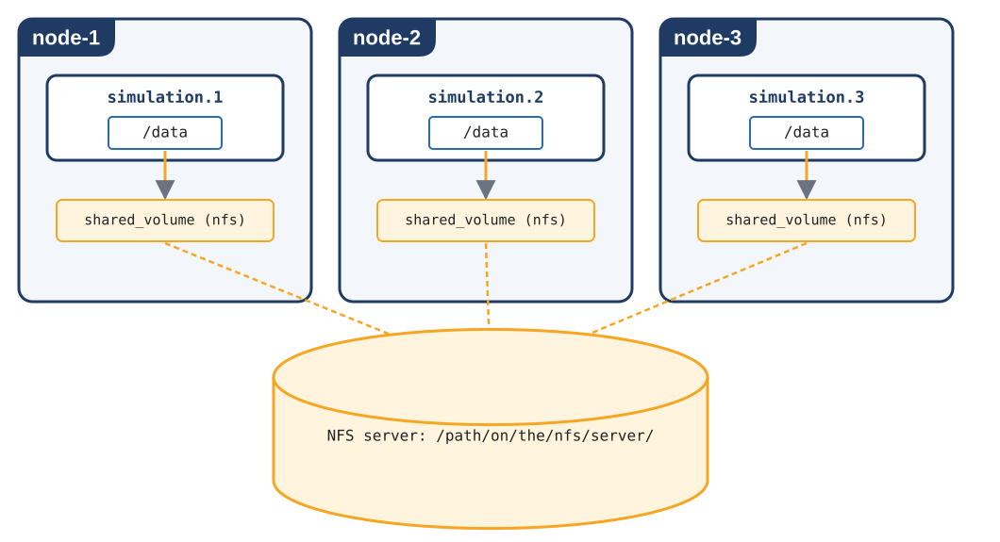
{}
{}

---

{}
